# Data Model

OpsDeck uses SQLAlchemy as its ORM with PostgreSQL as the sole supported database. The data model is organized into domain-specific model files with shared patterns for cross-cutting concerns.

## Entity relationship overview

```mermaid
erDiagram
    User ||--o{ AssetAssignment : "assigned to"
    User ||--o{ PolicyAcknowledgement : "acknowledges"
    User ||--o{ CourseAssignment : "assigned"
    User ||--o{ Permission : "has"
    User }o--|| Group : "belongs to"

    Asset ||--o{ AssetAssignment : "assigned via"
    Asset ||--o{ MaintenanceLog : "has"
    Asset ||--o{ DisposalRecord : "disposed via"
    Asset }o--o| Location : "located at"
    Asset }o--o| Supplier : "purchased from"

    Supplier ||--o{ Contract : "has"
    Supplier ||--o{ Subscription : "provides"
    Supplier ||--o{ Contact : "has contacts"

    Framework ||--o{ FrameworkControl : "defines"
    FrameworkControl ||--o{ ComplianceLink : "evidenced by"
    FrameworkControl ||--o{ AuditControlItem : "audited in"

    ComplianceAudit ||--o{ AuditControlItem : "contains"
    AuditControlItem ||--o{ AuditControlLink : "evidence"

    BusinessService ||--o{ ServiceComponent : "composed of"

    UARComparison ||--o{ UARExecution : "executed as"
    UARExecution ||--o{ UARFinding : "produces"

    Risk ||--o{ RiskHistory : "tracked over"
    Risk ||--o{ RiskAffectedItem : "affects"

    SecurityIncident ||--o{ IncidentTimelineEvent : "timeline"
    SecurityIncident ||--o| PostIncidentReview : "reviewed in"

    Policy ||--o{ PolicyVersion : "versioned"
    Policy ||--o{ PolicyAcknowledgement : "acknowledged via"
```



!!! note
    This diagram shows the core relationships. The full model has 80+ tables. See below for domain-specific details.

## Core entities

### Shared patterns

All major entities include these common fields:

- `id` — integer primary key, auto-incremented.
- `created_at`, `updated_at` — UTC timestamps, auto-managed.
- `created_by` — foreign key to `User`, set from Flask-Login session.
- `notes` — optional text field for free-form annotations.

### CustomPropertiesMixin

Models that include `CustomPropertiesMixin` (currently `Asset`, `User`, `Peripheral`) support arbitrary key-value custom fields:

- `CustomFieldDefinition` — defines a field name, type, and which entity types it applies to.
- `CustomFieldValue` — stores the actual value for a specific entity instance.
- Custom fields are rendered dynamically on forms and detail pages.

## Domain models

### Assets (`models/assets.py`)

| Model | Purpose |
|---|---|
| `Asset` | Hardware assets with lifecycle, warranty, and cost tracking |
| `AssetAssignment` | User-to-asset assignment history (start/end dates) |
| `AssetHistory` | Tracks status transitions for audit trail |
| `Peripheral` | Monitors, keyboards, headsets, etc. (with CustomProperties) |
| `PeripheralAssignment` | Peripheral assignment tracking |
| `Software` | Software inventory items |
| `License` | Software license tracking |
| `Location` | Physical/logical locations (supports hierarchy) |
| `MaintenanceLog` | Repair and maintenance records per asset |
| `DisposalRecord` | End-of-life disposal records |
| `DisposalHistory` | Status tracking for disposal workflows |

### Security & compliance (`models/security.py`)

| Model | Purpose |
|---|---|
| `Framework` | Compliance frameworks (ISO 27001, SOC 2, custom) |
| `FrameworkControl` | Individual controls within a framework |
| `ComplianceRule` | Compliance rules associated with controls |
| `ComplianceLink` | Polymorphic link between any entity and a control (evidence) |
| `Risk` | Risk register entries with scoring and treatment |
| `RiskCategory` | Risk categorization taxonomy |
| `RiskHistory` | Risk score changes over time |
| `RiskAffectedItem` | Links risks to affected assets/services |
| `SecurityIncident` | Security incident records |
| `IncidentTimelineEvent` | Incident investigation timeline |
| `PostIncidentReview` | Post-incident review records |
| `SecurityAssessment` | Security assessment records |
| `SecurityActivity` | Security operations activities |
| `CatalogRisk` / `RiskCatalog` | Predefined risk catalog entries |

### Audits (`models/audits.py`)

| Model | Purpose |
|---|---|
| `ComplianceAudit` | Audit snapshot — immutable once locked |
| `AuditControlItem` | Frozen copy of a control at snapshot time |
| `AuditControlLink` | Evidence linked to audit control items |

### UAR (`models/uar.py`)

| Model | Purpose |
|---|---|
| `UARComparison` | Comparison definition (two datasets + field mapping) |
| `UARExecution` | Single execution run with timestamp and status |
| `UARFinding` | Individual finding (orphan, missing, mismatch) |

### Procurement (`models/procurement.py`)

| Model | Purpose |
|---|---|
| `Supplier` | Vendor records with compliance status |
| `Subscription` | SaaS subscription tracking with renewal dates |
| `Contract` | Contract records with lifecycle dates |
| `ContractItem` | Line items within a contract |
| `Purchase` | Purchase orders |
| `Budget` | Budget records with validity periods |
| `PaymentMethod` | Payment method tracking |
| `CostHistory` | Cost tracking over time |

### Services (`models/services.py`)

| Model | Purpose |
|---|---|
| `BusinessService` | Business service definitions with criticality |
| `ServiceComponent` | Links assets, software, and other services as components |

### Authentication (`models/auth.py`)

| Model | Purpose |
|---|---|
| `User` | User accounts (with CustomProperties) |
| `Group` | Permission groups |
| `OrgChartSnapshot` | Point-in-time org chart captures |
| `UserKnownIP` | Known IP tracking for anomaly detection |

### Other domains

| File | Models |
|---|---|
| `policy.py` | `Policy`, `PolicyVersion`, `PolicyAcknowledgement` |
| `training.py` | `Course`, `CourseAssignment`, `CourseCompletion` |
| `onboarding.py` | `OnboardingPack`, `ProcessTemplate`, `ProcessItem`, `OffboardingProcess` |
| `credentials.py` | `Credential`, `CredentialSecret` (Fernet-encrypted) |
| `certificates.py` | `Certificate`, `CertificateVersion` |
| `change.py` | `Change` (change management records) |
| `bcdr.py` | `BCDRPlan`, `BCDRTestLog` |
| `risk_assessment.py` | `RiskAssessment`, `RiskAssessmentItem`, `RiskAssessmentEvidence` |
| `crm.py` | `Contact`, `Opportunity`, `Activity`, `Requirement` |
| `hiring.py` | `Candidate`, `HiringStage` |
| `finance.py` | `FinanceSettings`, `ExchangeRate` |
| `communications.py` | `Campaign`, `EmailTemplate`, `ScheduledCommunication` |
| `notifications.py` | `NotificationEvent` |
| `core.py` | `Attachment`, `Tag`, `Link`, `CostCenter`, `CustomFieldDefinition`, `CustomFieldValue`, `Documentation`, `OrganizationSettings`, `NotificationSetting` |

## Audit logging strategy

The `AuditLog` model captures every data mutation:

```
AuditLog
├── id
├── user_id          → User who made the change
├── action           → INSERT / UPDATE / DELETE
├── table_name       → Affected table
├── record_id        → Affected record
├── timestamp        → UTC timestamp
└── changes          → JSON diff (DeepDiff output)
```

The audit listener in `utils/audit_listener.py` hooks into SQLAlchemy's `after_insert`, `after_update`, and `after_delete` events globally. It captures changes automatically without requiring explicit logging calls in business logic.

## Soft deletes and history

Most entities use a soft-delete pattern rather than physical deletion. Disposed assets, closed contracts, and resolved incidents remain in the database with status fields indicating their state. This ensures audit trail continuity and supports historical reporting.

History tables (e.g., `AssetHistory`, `RiskHistory`, `CostHistory`) capture point-in-time snapshots for trending and timeline visualization.
