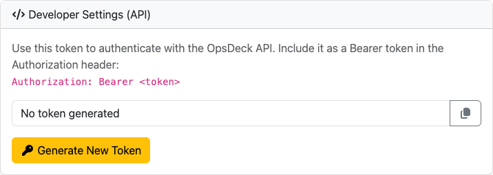

# REST API

OpsDeck provides a REST API under `/api/v1/` for reading inventory, people and supplier data, and for pushing changes, service requests, security incidents, onboardings and users in from other systems. It is built with flask-smorest and documented via OpenAPI/Swagger.

## Authentication

All API requests require a bearer token in the `Authorization` header:

```
Authorization: Bearer <your-api-token>
```

A request without a token, or with an unknown token, gets a `401` with a JSON body such as `{"error": "Token is invalid"}`. Successful and failed calls are written to the application log.

### Generating a token

1. Open the user menu (your name, top right) and choose **API Key** (`/my-api-key`).
2. Click **Generate New Token** and confirm.
3. Copy the token with the copy button next to the field.

Each user has at most one token. Generating a new one replaces the previous token, which stops working immediately. Administrators with write access to Administration can also generate a token for another user from that user's detail page (**Developer Settings (API)** card).



!!! warning "Treat tokens like passwords"
    Tokens are random 64-character hexadecimal strings, stored in the database as they are (not hashed). The token stays visible on your **API Key** page and to administrators on the user detail page, and generating a token records the old and new values in the [Audit Log](audit-log.md). There is no separate revoke action: generating a new token is how you invalidate the old one.

    API calls run as the token's owner, but the API does not check module permissions: any valid token can call every endpoint below.

## Swagger UI

Interactive API documentation is available while you are signed in to OpsDeck:

```
https://your-opsdeck-instance/swagger-ui
```

The raw OpenAPI spec is at `/openapi.json`. The Swagger UI lets you browse endpoints and request/response schemas, and test calls from the browser (click **Authorize** and paste your token).

## Endpoints

| Endpoint | Methods | Entity |
|---|---|---|
| `/api/v1/users` | GET, POST | Users |
| `/api/v1/assets` | GET | Hardware assets |
| `/api/v1/peripherals` | GET | Peripherals |
| `/api/v1/licenses` | GET | Software licenses |
| `/api/v1/subscriptions` | GET | Subscriptions |
| `/api/v1/services` | GET | Business services |
| `/api/v1/suppliers` | GET | Suppliers |
| `/api/v1/contacts` | GET | Contacts |
| `/api/v1/changes` | GET, POST | Change records |
| `/api/v1/requests` | GET, POST | Service requests |
| `/api/v1/incidents` | POST | Security incidents |
| `/api/v1/onboardings` | POST | Onboarding processes |

Every endpoint with GET also has a detail route, `/api/v1/{resource}/{id}`, which returns one record or a `404`. Incidents and onboardings are write-only: there is no GET for them.

Responses contain the record's columns, including foreign-key IDs (for example `user_id`, `supplier_id`). User responses never include the password hash or the API token.

## Pagination

List endpoints take two optional query parameters:

| Parameter | Default | Meaning |
|---|---|---|
| `limit` | 100 | Maximum number of records to return |
| `offset` | 0 | Number of records to skip |

```
GET /api/v1/assets?limit=50&offset=100
```

The response is a plain JSON array of records, with no envelope and no total count. To read everything, keep increasing `offset` until a page returns fewer records than `limit`. List endpoints have no field filters.

## Creating and updating records

Every POST endpoint is an upsert: it updates the matching record if there is one, and creates a new record otherwise.

| Endpoint | Matched by |
|---|---|
| `/api/v1/users` | `email` |
| `/api/v1/changes`, `/api/v1/requests`, `/api/v1/incidents`, `/api/v1/onboardings` | `external_ref` |

`external_ref` (up to 255 characters) is usually the record's ID in the source system, for example a Jira issue key. Without `external_ref`, every call creates a new record.

- A create returns `201` and an update returns `200`; both return the full record.
- On update, fields you omit or send as `null` keep their current value.
- People fields (`requester`, `assignee`, `owner`, `reported_by`, `manager`, `buddy`) take an email address or a user's exact name. Archived and unknown users are ignored.
- An invalid payload gets a `422` listing the validation errors.

### Users

| Field | Required | Values |
|---|---|---|
| `email` | Yes | Email address, used as the match key |
| `name` | Yes | Up to 100 characters |
| `department`, `job_title` | No | Up to 100 characters |
| `personal_email` | No | Up to 120 characters |
| `role` | No | Defaults to `user` |

### Changes

| Field | Required | Values |
|---|---|---|
| `title` | Yes | Up to 200 characters |
| `description`, `implementation_plan`, `rollback_plan`, `test_plan` | No | Text |
| `change_type` | No | `Standard` (default), `Normal`, `Emergency` |
| `priority` | No | `Low`, `Medium` (default), `High`, `Critical` |
| `risk_impact` | No | `Low` (default), `Medium`, `High` |
| `status` | No | Defaults to `Draft` |
| `requester` | No | Defaults to the token owner on create |
| `assignee`, `external_ref` | No | |

### Requests

| Field | Required | Values |
|---|---|---|
| `title` | Yes | Up to 200 characters |
| `description`, `justification`, `resolution_notes` | No | Text |
| `request_type` | No | `General` (default), `Access`, `Hardware`, `Software`, `Information` |
| `priority` | No | `Low`, `Medium` (default), `High`, `Critical` |
| `status` | No | Defaults to `Pending` |
| `requester` | No | Defaults to the token owner on create |
| `assignee`, `external_ref` | No | |

### Incidents

| Field | Required | Values |
|---|---|---|
| `title` | Yes | Up to 255 characters |
| `description` | Yes | Text |
| `severity` | No | `SEV-0`, `SEV-1`, `SEV-2`, `SEV-3` (default) |
| `impact` | No | `Minor` (default), `Moderate`, `Significant`, `Extensive` |
| `status` | No | Defaults to `Investigating` |
| `reported_by` | No | Defaults to the token owner on create |
| `owner`, `assignee`, `external_ref` | No | |

### Onboardings

| Field | Required | Values |
|---|---|---|
| `new_hire_name` | Yes | Up to 100 characters |
| `start_date` | Yes | Date, `YYYY-MM-DD` |
| `status` | No | Defaults to `Provisioning` |
| `manager`, `buddy` | No | Email or name |
| `pack_id` | No | ID of an onboarding pack |
| `target_email`, `personal_email`, `external_ref` | No | |

## Rate limits

API calls count against the application's per-IP rate limit (1,000 requests per hour and 10,000 per day). A call over the limit gets a `429` with a JSON error.

## Example: list assets

```bash
curl -H "Authorization: Bearer YOUR_TOKEN" \
  "https://opsdeck.example.com/api/v1/assets?limit=100&offset=0"
```

## Example: create or update an incident

```bash
curl -X POST \
  -H "Authorization: Bearer YOUR_TOKEN" \
  -H "Content-Type: application/json" \
  -d '{"title": "Unauthorized access attempt", "description": "Repeated failed logins on the VPN gateway.", "severity": "SEV-2", "impact": "Moderate", "owner": "secops@example.com", "external_ref": "SIEM-4821"}' \
  https://opsdeck.example.com/api/v1/incidents
```

Sending the payload again with the same `external_ref` updates the existing incident instead of creating a duplicate.
