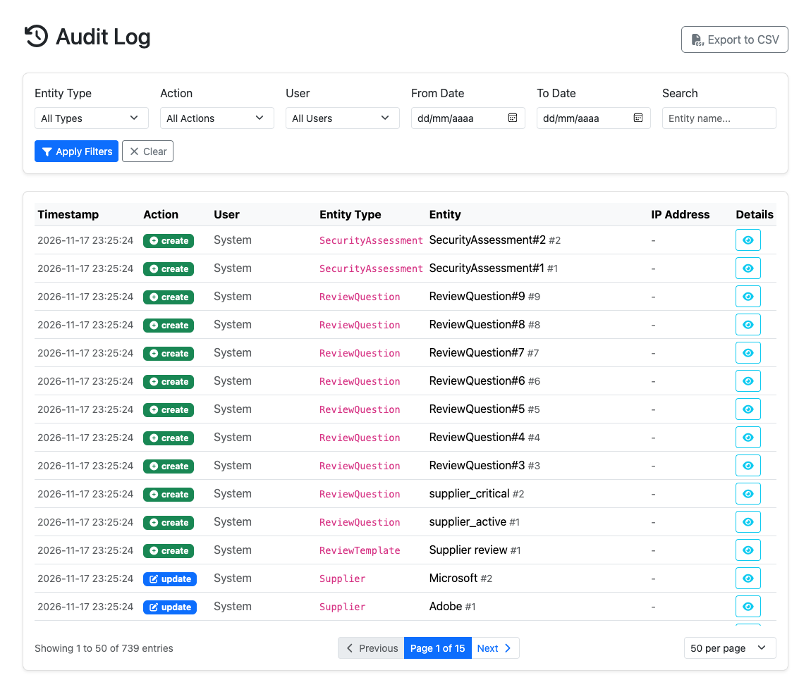

# Audit Log

The audit log records every create, update and delete made to OpsDeck's data, with who made it, from which IP address, and which fields changed. It is read-only: entries cannot be edited or deleted from the application.

Open it from **Administration → Audit Log** (`/admin/audit-log`). Read-only access to the `administration` module is enough.

## What is recorded

OpsDeck writes an entry automatically whenever a record is saved, whatever made the change: a user in the web interface, an API call, an import, or a background job.

| Column | Content |
|---|---|
| **Timestamp** | When the change was committed |
| **Action** | `create`, `update` or `delete` |
| **User** | The signed-in user who made the change, or **System** when there was none |
| **Entity Type** | The kind of record, by its internal model name (for example `Asset`, `Supplier`, `FrameworkControl`) |
| **Entity** | The record's name, title or email, and its ID |
| **IP Address** | The address the request came from, or `-` for background jobs |
| **Details** | Opens the change details, when there are any |

For updates, only the fields that actually changed are recorded, with their old and new values. For creates and deletes, the entry holds a snapshot of the record's fields. Updates that change nothing do not create entries.

Some data is left out:

- Password hashes and fields named `password`, `secret`, `token`, `api_key`, `encrypted_value`, `secret_key` or `private_key`, as well as `created_at` and `updated_at`.
- Scheduled communications, exchange rates and notification settings, which change too often to be useful.

Changes made by scheduled jobs, such as the scheduled Microsoft Entra ID sync or the daily job that opens supplier reviews, are recorded like any other change, with **System** as the user and no IP address. When an administrator runs the Entra ID sync from the web interface, the resulting user changes are recorded under that administrator.

## Filtering

| Filter | Matches |
|---|---|
| **Entity Type** | One entity type; the list contains the types that have entries |
| **Action** | Create, Update or Delete |
| **User** | Changes made by one user |
| **From Date**, **To Date** | Entries on or between the dates (both inclusive) |
| **Search** | Text in the entity name (case-insensitive) |

Click **Apply Filters** to apply and **Clear** to reset. **Export to CSV** downloads every entry that matches the current filters, not only the visible page; each export is itself recorded. Entries are listed newest first, 50 per page by default; you can switch to 25 or 100 per page at the bottom of the list.

## Viewing change details

Click the eye button in the **Details** column to open **Change Details**. It shows the action, entity type and ID, name, user, IP address and timestamp, followed by a table with each field's **Old Value** and **New Value**.

Fields that hold secrets (passwords, tokens, API keys, connector credentials) are recorded as `[REDACTED]`, so the log shows that they changed without their values.

The same information is available as JSON at `/admin/audit-log/<id>/detail` to signed-in users with access to Administration.

## Related

- Entries are also the event source for **Settings → Event Rules**: each new entry is matched against the configured rules once.
- Security events such as sign-ins, token generation and Entra ID sync runs are written to the application's structured (ECS) log, not to this page. See [Security Model](../architecture/security-model.md).
