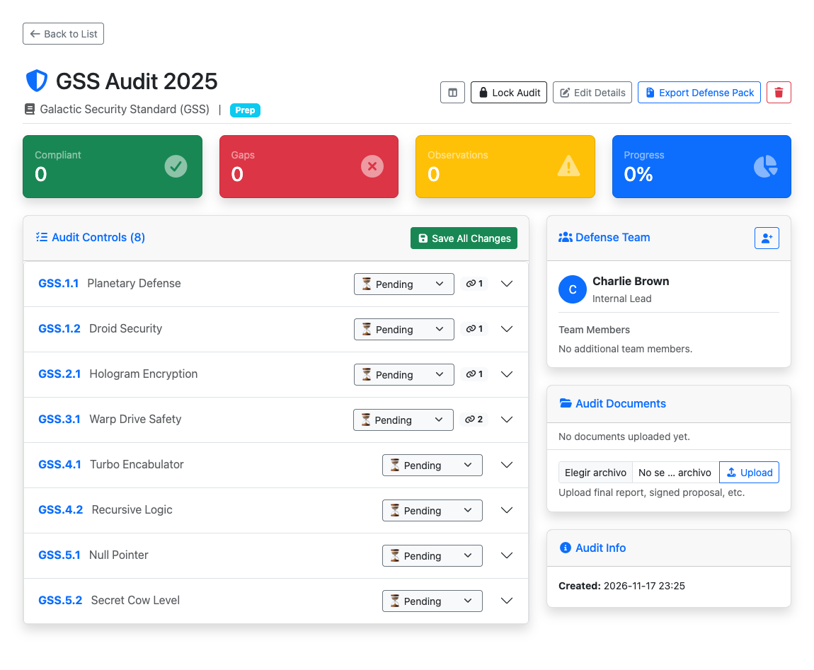

# Audit Snapshots

Audit snapshots capture a framework's controls and evidence at a specific point in time, giving the audit its own record that later changes to the live framework do not affect. This is OpsDeck's "defense room": the page you work from during an external audit.

Audits are under **Risk & Governance → Audits** (`/security/audits/`). Viewing them requires read access to the `compliance` module; creating, editing, locking, unlocking and deleting require write access.

## Audit creation strategies

| Strategy | When to use |
|---|---|
| **Start from Scratch** | First-time audit, new framework, or a complete reassessment |
| **Renewal / Rollover** | Subsequent audits that build on a previous audit |

## Creating an audit

1. Go to **Risk & Governance → Audits** and click **New Audit**.
2. Choose a **Strategy**.
3. For **Start from Scratch**: enter the **Audit Name**, pick an active framework under **Select Framework**, and optionally tick **Pre-fill evidences from Framework** to copy the evidence currently linked to each control.
4. For **Renewal / Rollover**: pick the **Source Audit** and an optional **Target Completion Date**. The new audit is named "Renewal <year>: <source name>".
5. Under **Automated Evidence Collection**, set the **Evidence Collection Period (Months)** (default 6) and, optionally, **Enable Random Sampling** with a **Sample Size** (default 3) to limit automated evidence per control.
6. Under **Team Assignment**, pick the **Internal Lead** (required) and, optionally, the **External Auditor** (a contact).
7. Click **Create Audit Snapshot**.

OpsDeck creates one audit item per framework control, copying its code, title and description. For each control with enabled automation rules, it also collects matching evidence from the collection period (for example security activity executions or supplier assessments) and links it as automated evidence.

### Statement of Applicability in new audits

Each audit item inherits the control's applicability and justification from the [Statement of Applicability](frameworks.md#statement-of-applicability-soa) on the framework. Items for non-applicable controls start with status **Not Applicable**; all others start as **Pending**.

A renewal takes applicability, justification and internal comments from the source audit's items instead, resets statuses to **Pending** (or **Not Applicable**), copies the framework's evidence links and the source audit's manual evidence (without duplicates), and collects fresh automated evidence.

## Working with the audit

The audit page shows the audit controls as an accordion, a sidebar with the **External Auditor**, **Defense Team**, **Audit Documents** and **Audit Info**, and a toolbar with the audit actions.

For each control item you can set:

| Field | Purpose |
|---|---|
| **Is applicable** / **Justification (SOA)** | Applicability of the control for this audit |
| **Internal Comments** | Private notes for the defense team |
| **Auditor Findings** | Notes from the auditor |
| **Status** | Pending, Compliant, Observation, Gap, Not Applicable |

The status dropdown in each item's header saves immediately. Changes made inside the item are saved with **Save All Changes**.

Use **Edit Details** to set the audit **Status** (Planned, Prep, Auditor Review, Closed), **Outcome** (Pass, Fail, Qualified), and start and end dates. Add colleagues to the **Defense Team** and upload audit-wide files under **Audit Documents**.

## Linking additional evidence

While the audit is unlocked, each control item lets you:

- Upload files as evidence for that control.
- Click **Link Object** to link an asset, policy, documentation page, link, training course, risk, org chart snapshot, software, supplier, service, or onboarding/offboarding process, with an optional description.
- Remove links that no longer apply.

Evidence linked here belongs to the audit only; it does not change the live framework.

## Locking and unlocking

When the audit is ready for the auditor:

1. Click **Lock Audit** and confirm.
2. The audit shows **AUDIT LOCKED**. Item edits, evidence links, uploads, **Edit Details** and delete are disabled.

If you need to make further changes, click **Unlock** and confirm. Unlocking requires write access to the `compliance` module and makes the audit editable again until you lock it again.

## Exporting for auditors

Click **Export Defense Pack** on the audit page to download a ZIP file (`audit_<id>_<name>_<timestamp>.zip`) containing:

| Item | Content |
|---|---|
| `Defense_Pack_Report.pdf` and `Defense_Pack_Report.html` | Audit information, control status summary, and the Statement of Applicability table (code, control, applicable, status, number of evidence items per control) |
| `evidence/<control code>/` | One folder per control, with each linked evidence item rendered as HTML and PDF, and an `attachments/` subfolder with files uploaded to the control or attached to the evidence |
| `external_links.txt` | External URLs referenced by linked links and documentation (only when there are any) |
| `manifest.json` | Audit metadata, export timestamp, statistics and the external links |

The audit list also has an **Export PDF** action per audit, which downloads a single PDF (`defense_pack_<id>.pdf`) without the evidence files.

## Audit cloning

For recurring audits (for example annual ISO 27001 surveillance), use a renewal instead of starting over:

1. Click **New Audit** and choose **Renewal / Rollover**.
2. Select the previous audit as the **Source Audit**.
3. Review the new audit: confirm statuses, add new evidence, and remove obsolete links.
4. Lock when ready.
