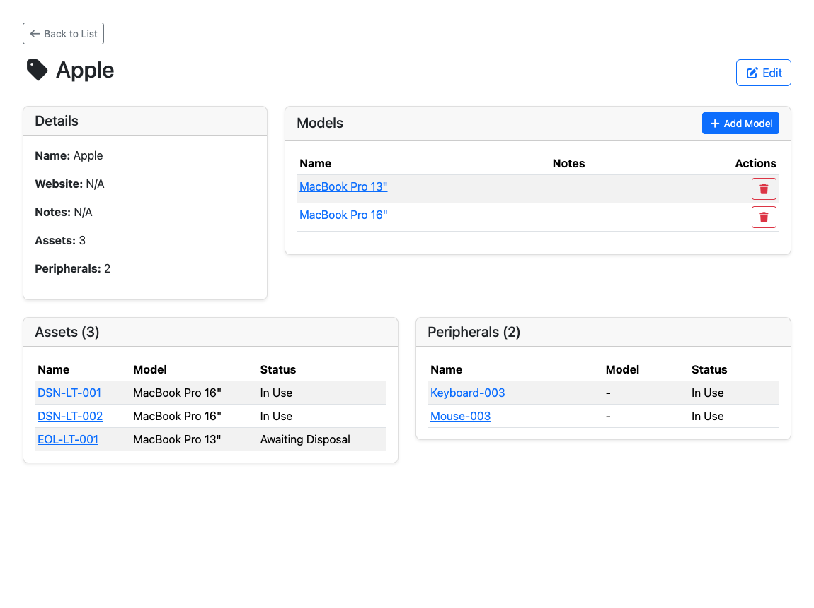
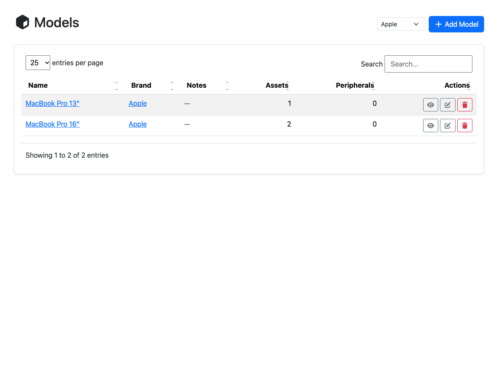

# Brands & Models

Brands and models describe who made a piece of hardware and which product it is (for example *Dell* / *XPS 15*). Assets and peripherals share the same list of brands and models, so reports can group your fleet by manufacturer.

A brand is not the same as a [supplier](suppliers.md): the supplier is the company you buy from, the brand is the manufacturer. The same Dell laptop can be bought from several resellers.

Brands and models are part of the **Core Inventory** module. Viewing them needs read access to Core Inventory; creating, editing and deleting needs write access.

## Brands

Open **Core Inventory → Brands** (`/brands/`). The list shows each brand's website and how many models, assets and peripherals use it.

### Adding a brand

1. Click **Add Brand**.
2. Fill in the fields and save.

| Field | Description |
|---|---|
| **Name** | Required. Must be unique: OpsDeck refuses a second brand with the same name. |
| **Website** | Optional manufacturer website. |
| **Notes** | Optional free text. |

### Brand detail

The brand page shows its details and three lists:

- **Models**: the brand's models. Click **Add Model** to create one without leaving the page (name and notes), or delete a model from the list.
- **Assets**: every asset of this brand, with its model and status.
- **Peripherals**: every peripheral of this brand, with its model and status.

## Models

Open **Core Inventory → Models** (`/asset-models/`). The list shows each model with its brand, notes and the number of assets and peripherals using it. Use the **All brands** selector to show only one brand's models.

### Adding a model

Click **Add Model** on the models list, or **Add Model** on a brand's page.

| Field | Description |
|---|---|
| **Name** | Required. Must be unique within the brand: two brands can each have a model with the same name. |
| **Brand** | Required. A model belongs to exactly one brand. |
| **Notes** | Optional free text. |

### Model detail

The model page lists the assets (name, serial, status, assigned user) and peripherals (name, status, assigned user) that use the model.

## Choosing a brand and model on an asset or peripheral

The asset and peripheral forms have a **Brand** selector and a **Model** selector that only offers the models of the selected brand. If the brand or model you need does not exist yet, use the **+** button next to either selector to create it in place; the new entry is selected for you.

## Deleting brands and models

A brand or model that is still used by any asset or peripheral cannot be deleted. OpsDeck shows how many assets and peripherals use it; reassign or remove them first.

Deleting a brand also deletes all of its models.

## Brand reports

**Operations → Asset Reports** (`/reports/assets-dashboard`) uses the brand of each asset to show:

- **Fleet Distribution by Brand**: how many assets you have of each brand.
- **Breakdown Rate by Brand**: the share of each brand's assets with a Repair maintenance entry in the last 12 months.
- The brand of each asset in the **Warranty Expiring Soon** and **Top Problematic Assets** tables.
