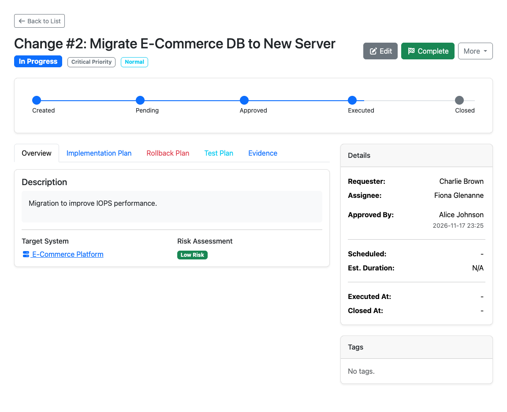

# Change Management

Track changes to infrastructure, services and configuration with a plan, an approval step and evidence of what was done.

Open the module from **Operations → Changes** (`/changes/`). Changes belong to the `operations` permission module: read access lets you view changes, write access is needed to create, edit, approve and execute them.

## Creating a change

1. Navigate to **Operations → Changes**.
2. Click **New Change** (or **Request Change** in the Quick Actions of [My Dashboard](dashboard.md#my-dashboard)).
3. On the **General Information** tab, fill in:

    | Field | Description |
    |---|---|
    | **Title** | Required. |
    | **Description / Business Case** | What is changing and why. |
    | **Target Type** / **Target Item** | Optional: a Business Service, Asset, Software, or Configuration (CMDB). For a configuration you also pick the version, or create a new one with **New Ver.** |
    | **Tags** | Optional labels. |
    | **Requires Approval** | On by default. If off, the change skips the Pending Approval step. Cannot be changed after creation. |
    | **Change Type** | Standard (pre-approved), Normal (review required) or Emergency (immediate). |
    | **Priority** | Low, Medium, High or Critical. |
    | **Risk Impact** | Low, Medium or High. |
    | **Scheduled Start** / **Scheduled End** | Planned implementation window. |
    | **Estimated Duration (mins)** | Expected duration. |
    | **Assignee** | The person who will implement the change. |

4. On the **Planning & Validation** tab, fill in the plans:

    | Plan | Content |
    |---|---|
    | **Implementation Plan** | The technical steps. |
    | **Rollback Plan** | How to revert if something goes wrong. |
    | **Test Plan** | How to verify the change worked. |

    All three are **mandatory for Normal and Emergency changes**. The change is not created if one is missing.

5. Click **Create Change Request**. You are recorded as the requester.

## Change types

| Type | Description |
|---|---|
| **Standard** | Pre-approved, low-risk, routine changes. |
| **Normal** | Requires assessment and approval before implementation. |
| **Emergency** | Urgent changes that must be implemented immediately. |

## Statuses

| Status | Meaning |
|---|---|
| **Draft** | Not yet submitted. Changes created in the web interface skip this status. |
| **Pending Approval** | Waiting for approval. Starting status when **Requires Approval** is on. |
| **Approved** | Ready to implement. Starting status when **Requires Approval** is off (the change is auto-approved by the requester). |
| **In Progress** | Being implemented. |
| **Completed** | Implemented successfully. |
| **Failed** | Implementation failed. |
| **Cancelled** | Withdrawn. |

## Working a change

The detail page shows the buttons available for the current status:

| From | Button | To |
|---|---|---|
| Pending Approval | **Approve** | Approved |
| Approved | **Start Execution** | In Progress |
| In Progress | **Complete** | Completed |
| Draft, Pending Approval, Approved or In Progress | **More → Cancel Request** | Cancelled |

**Segregation of duties:** the requester cannot approve their own change. The **Approve** button is disabled for them unless they are an administrator. OpsDeck records who approved the change and when, when execution started, and when the change was closed.

Changes can be edited until they are Completed, Failed or Cancelled.

## Change detail

The detail page shows:

- A **step timeline** across the top: Created, Pending, Approved, Executed, Closed.
- Tabs for **Overview**, **Implementation Plan**, **Rollback Plan**, **Test Plan** and **Evidence**.
- The people involved (requester, assignee, approved by) and the dates (scheduled window, estimated duration, executed at, closed at).

On the **Evidence** tab you can upload files, such as logs, screenshots or approval records, as proof of the change. Uploading requires write access.

## Finding changes

The list shows ID, title, type, priority, status, scheduled date, requester and assignee. Use the **Filter** menu to show Draft, Pending Approval, Approved, In Progress or Completed changes. You can also filter with URL parameters, and combine them:

| Parameter | Example |
|---|---|
| `status` | `/changes/?status=Pending Approval` |
| `type` | `/changes/?type=Emergency` |
| `priority` | `/changes/?priority=Critical` |

Changes **assigned to you** that are still open appear in **Your Pending Tasks** on My Dashboard and in the notification bell. Changes **you requested** appear in **My Tickets**. See [Dashboard](dashboard.md#my-dashboard).

## API

- `GET /api/v1/changes` lists changes (`limit` and `offset` parameters).
- `GET /api/v1/changes/<id>` returns one change.
- `POST /api/v1/changes` creates a change, or updates the existing one with the same `external_ref`. Use this to sync changes from another tool. `requester` and `assignee` are matched by email or name; without a requester, the API token's user is used. Changes created through the API start in `Draft` unless you send a `status`.

See [REST API](api.md) for authentication.
