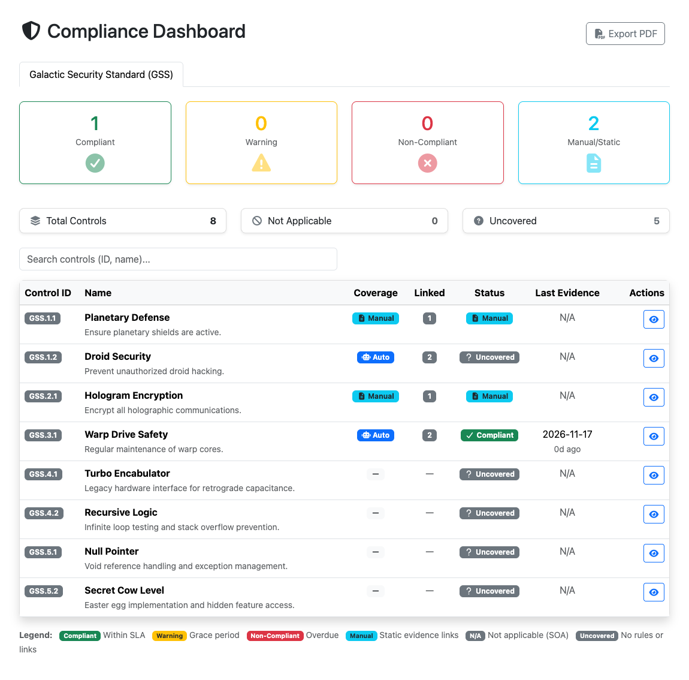

# Compliance Dashboard

The compliance dashboard shows the current compliance status of every active framework, evaluated live from automation rules and linked evidence.

Open it from **Compliance → Compliance Dashboard** (`/compliance/dashboard`). It requires read access to the `compliance` module.

## Layout

The dashboard has one tab per active framework, ordered by name. A tab shows a red badge with the number of non-compliant controls, or a yellow badge with the number of warnings when there are none.

Each tab contains:

- **Summary cards** — counts of Compliant, Warning, Non-Compliant and Manual/Static controls.
- **Secondary counts** — Total Controls, Not Applicable and Uncovered.
- **Search box** — filters the table by control ID or name.
- **Controls table** — Control ID, Name, Coverage (automated, manual or none), Linked (number of rules plus manual links), Status, Last Evidence, and a button that opens the control detail page.

Inactive frameworks are not shown. To show a framework, mark it **Active** under [Frameworks](frameworks.md).

## Control status

Each control gets one status:

| Status | Meaning |
|---|---|
| **Compliant** | Every enabled automation rule found evidence within its frequency |
| **Warning** | At least one rule's latest evidence is in the grace period, and none is overdue |
| **Non-Compliant** | At least one rule's evidence is overdue or missing |
| **Manual** | No enabled rules, but the control has manual evidence links |
| **N/A** | The control is marked not applicable in the Statement of Applicability, so it is not evaluated |
| **Uncovered** | No rules and no manual links |

The worst rule result wins: one overdue rule makes the control non-compliant even if its other rules are fine. **Last Evidence** shows the oldest of the rules' latest evidence dates. Rules are described in [Frameworks & Controls](frameworks.md#automation-rules).

## Exporting to PDF

Click **Export PDF** to download `compliance_report.pdf` (`/compliance/dashboard/pdf`). It contains the same data as the dashboard: per framework, the status counts and each control's ID, name, status, evidence source and last evidence date.

## Evidence linking

Manual evidence is linked to controls through **Compliance Links**, from either direction:

**From the control.** On the control detail page, click **Link Manual Item**, choose the evidence type (Policy, Documentation, Service, or External Link / Bookmark), pick the item and add a description.

**From the record.** Many records, including assets, peripherals, licenses, software, subscriptions, suppliers, purchases, policies, documentation and security incidents, have a **Compliance Links** card. Click **Add Link**, choose the **Framework** and **Control**, explain under **Description / Justification** how the record satisfies the control, and click **Link Control**. Only active frameworks can be linked, and the same record cannot be linked to the same control twice.

Creating and removing links requires write access to the `compliance` module.

!!! tip
    Link evidence continuously as part of daily operations, not just during audit preparation. Audits created with **Pre-fill evidences from Framework** copy these links, so a well-maintained set of links makes each audit start almost complete.

## Relationship to other modules

- **Frameworks and the SoA** — controls, applicability and automation rules. See [Frameworks & Controls](frameworks.md).
- **Audit snapshots** — frozen compliance state at a point in time. See [Audit Snapshots](audits.md).
- **Compliance drift** — detection of status regressions over time. See [Compliance Drift](compliance-drift.md).
- **Supplier reviews** — completed reviews are evidence for supplier assessment rules. See [Supplier Reviews](supplier-reviews.md).
- **Risk register** — risks can be linked to controls through compliance links. See [Risk Register](risk.md).
