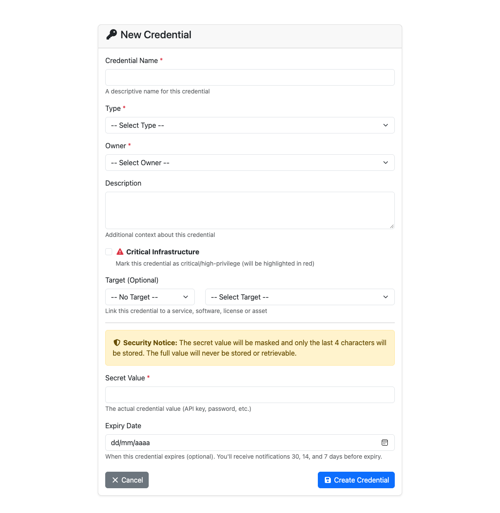

# Credentials

Track the lifecycle of credentials (API keys, service accounts, passwords, certificates): who owns them, what they give access to, when they expire and when they were rotated.

OpsDeck is **not a password vault**. It never stores the secret itself. When you enter a secret, OpsDeck keeps only a masked value (asterisks plus the last 4 characters) so people can tell which key is in use. Keep the real secret in your password manager or secrets store.

Credentials are part of the **Core Inventory** module.

## Adding a credential

1. Navigate to **Core Inventory → Credentials**.
2. Click **New Credential**.
3. Fill in the fields below and save.

| Field | Description |
|---|---|
| **Credential Name** | Required. A descriptive name, e.g. "Stripe production API key". |
| **Type** | Required: API Key, OAuth, Service Account, SSH Key, Password or Certificate. |
| **Owner** | Required. The user responsible for the credential. Expiry reminders are sent to this user. |
| **Description** | Optional context. |
| **Critical Infrastructure** | Break-glass flag for critical or high-privilege credentials. The credential is highlighted with a red **Critical Infrastructure** badge. |
| **Target** | Optional. The software, license or asset the credential belongs to. |
| **Secret Value** | Required when creating. Masked before it is saved (see below). |
| **Expiry Date** | Optional. Used for expiry status, reminders and the renewal calendar. |

## How secrets are masked

The secret value is masked as soon as you submit the form. Only the masked value is saved:

| Secret entered | Stored as |
|---|---|
| 4 characters or fewer | `****` |
| Longer | Asterisks followed by the last 4 characters, at most 16 characters in total, e.g. `***********1234` |

The full value cannot be retrieved from OpsDeck, and there is no reveal action. The secret is not shown again when you edit the credential.

## Credential list

The list shows each credential's name, type, owner, target, masked value, expiry date and status. Filter by type, by status (Active, Expiring Soon, Expired) or search by owner or credential name.

## Expiry status

The status is calculated from the expiry date of the active secret:

| Status | Meaning |
|---|---|
| **Active** | No expiry date, or more than 30 days left. |
| **Expiring (30d)** | Expires within 30 days. |
| **Expiring Soon (7d)** | Expires within 7 days. |
| **Expired** | The expiry date has passed. |

The owner receives an email when the active secret is 30, 14 and 7 days from expiry. Expired credentials appear as critical items on the **Health Dashboard**, and expiry dates are shown on the [Renewal Calendar](subscriptions.md#renewal-calendar).

## Rotating a secret

When you replace a credential in the external system, record the rotation in OpsDeck:

1. Open the credential.
2. Click **Rotate Secret**.
3. Enter the **New Secret Value** (it is masked like the original) and optionally a **New Expiry Date**.
4. Click **Rotate Secret**.

The new secret becomes the active one and all previous secrets are deactivated. The **Secret History** section keeps every masked value with its creation date, expiry and status, so you can show when a key was rotated.

## Linking credentials

A credential can be linked to:

- **Business services**: from the service page, link existing credentials (see [Service Catalog](services.md)). A service can use several credentials, and a credential can serve several services.
- **Software, a license or an asset**: with the **Target** field on the credential form.

The credential page shows the linked target, and the linked services show the credential.

## Deleting a credential

Use **Delete Credential** in the **Danger Zone** of the credential page. This also deletes its secret history.
