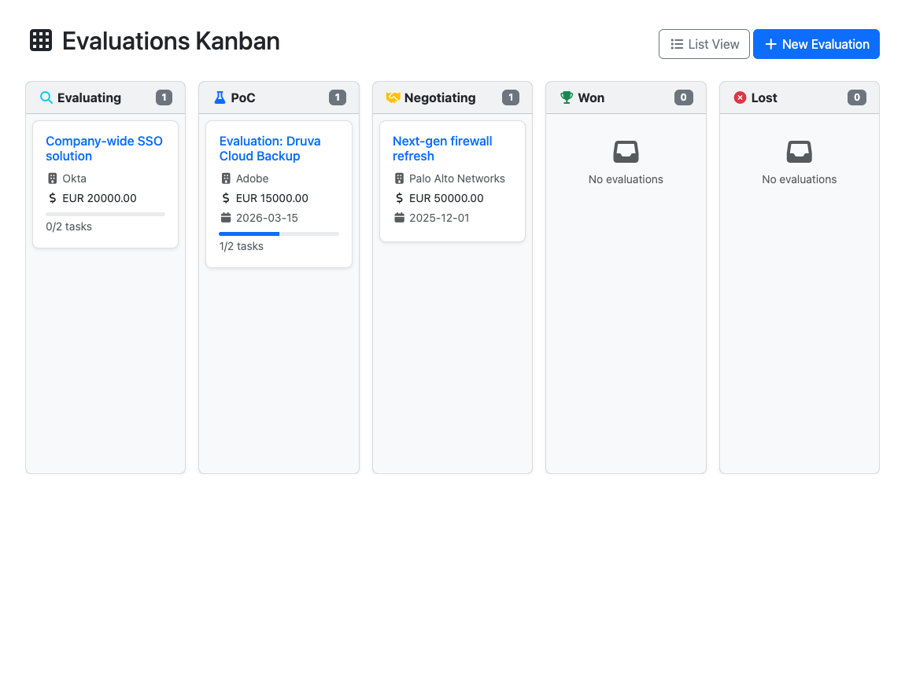
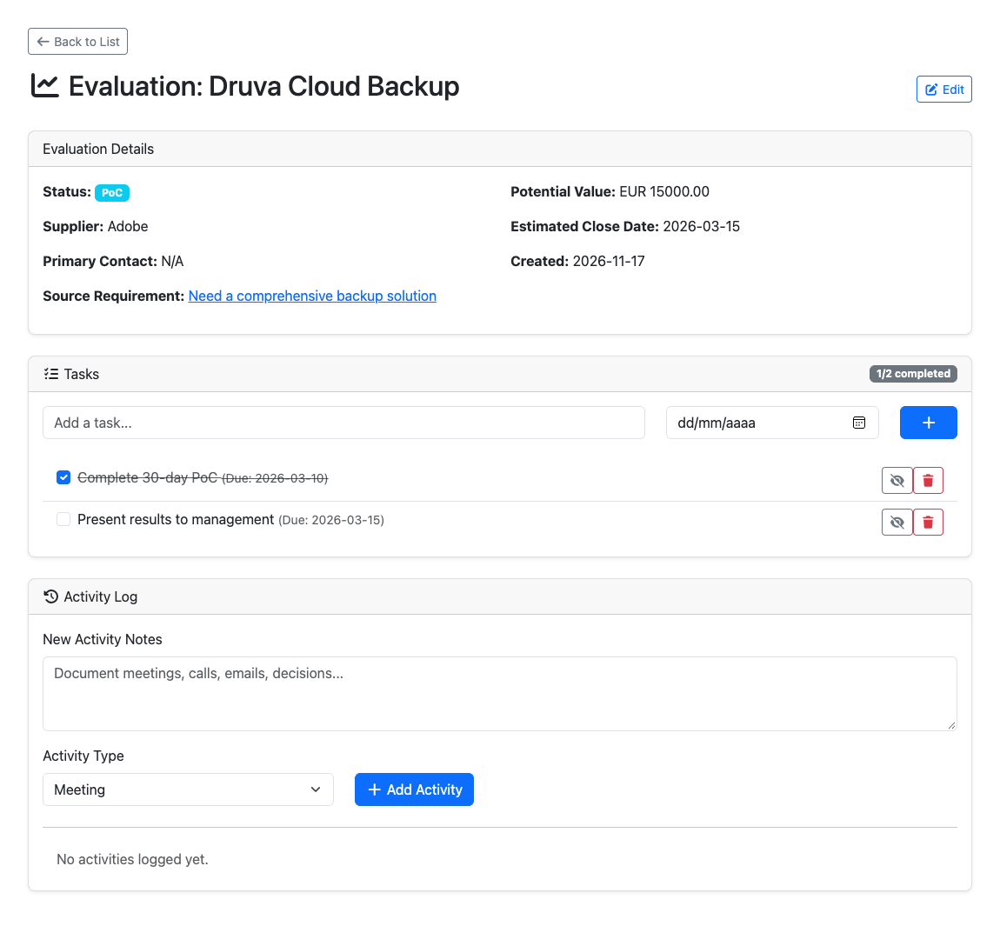

# Requirements, Evaluations & Contacts

The **Procurement** menu covers buying decisions from the first need to the chosen supplier:

- **Requirements**: something the organization needs (a tool, hardware, a service).
- **Evaluations**: the assessment of a possible solution or supplier for a requirement.
- **Suppliers** and **Contracts**: see [Suppliers](suppliers.md) and [Contracts](contracts.md).
- **Contacts**: the people you deal with at each supplier.

All of these are part of the **Procurement** module. Viewing needs read access; creating and editing needs write access.

!!! note
    Earlier versions had a CRM module with Leads and Opportunities. Leads are now **Requirements** and opportunities are now **Evaluations**. There is no separate CRM menu any more.

## Requirements

### Adding a requirement

1. Navigate to **Procurement → Requirements**.
2. Click **New Requirement**.
3. Fill in the fields and save.

| Field | Description |
|---|---|
| **Requirement Name** | Required. A clear, descriptive name. |
| **Type** | Software, Hardware, Service, Consulting, License, Subscription or Other. |
| **Priority** | Low, Medium (default), High or Critical. |
| **Status** | See below. |
| **Estimated Budget** and **Currency** | Currency is EUR, USD or GBP. |
| **Needed By** | Target date. |
| **Description** | What is needed and why, with any constraints. |

### Requirement statuses

| Status | Meaning |
|---|---|
| **New** | Just recorded. Default. |
| **Researching** | Looking at options. |
| **Evaluating** | One or more evaluations are under way. |
| **Converted** | Turned into an evaluation or a supplier (set automatically by **Convert**). |
| **Rejected** | Will not be pursued. |

The requirements list can be searched, filtered by status, priority and type, sorted, and exported with **Export to CSV**.

### Actions and notes

On the requirement page, use **Actions & Notes** to log progress. Choose an **Action Type** (Note, Research, Meeting, Decision or Email), write the text and click **Add Action**. Entries can be edited, hidden or deleted.

### Converting a requirement

Click **Convert** on the requirement page and choose:

- **Evaluation**: creates an evaluation named "Evaluation: *requirement name*" with status Evaluating, linked to the requirement, with the requirement's budget as potential value. The evaluation form opens so you can complete it.
- **Supplier**: creates a supplier with the requirement's name and opens the supplier form.

Either way the requirement's status becomes **Converted**. A requirement can be converted only once; you can still link more evaluations to it from the evaluation form. The requirement page lists its **Related Evaluations**.

### Timeline view

Click **Timeline View** on the requirements list to see each requirement next to its evaluations and the suppliers of those evaluations.

## Evaluations

An evaluation tracks one possible solution: the supplier, its value, the tasks to complete and what was discussed.

### Adding an evaluation

1. Navigate to **Procurement → Evaluations**.
2. Click **New Evaluation** (or convert a requirement).
3. Fill in the fields and save.

| Field | Description |
|---|---|
| **Evaluation Name** | Required. |
| **Status** | See below. |
| **Estimated Close Date** | When you expect a decision. |
| **Potential Value** and **Currency** | Expected cost of the solution. |
| **Supplier** | The supplier being evaluated. |
| **Primary Contact** | A contact at a supplier. |
| **Source Requirement** | The requirement this evaluation answers. |
| **Related Risk** | A risk from the risk register that the solution addresses. |
| **Budget** | The budget it would be paid from. |
| **Notes** | Free text. |

### Evaluation statuses

| Status | Meaning |
|---|---|
| **Evaluating** | Gathering information. Default. |
| **PoC** | Proof of concept or trial in progress. |
| **Negotiating** | Negotiating price and terms. |
| **Won** | The solution was chosen. |
| **Lost** | The solution was rejected. |

The list can be filtered by status, supplier and whether the evaluation is linked to a requirement, and shows how many of each evaluation's tasks are completed.

### Kanban view

Click **Kanban View** to see evaluations in one column per status, ordered by estimated close date. Users with write access can drag a card to another column to change its status.

### Tasks and activity log

The evaluation page has two working areas:

- **Tasks**: action items with an optional due date. Check them off when done; tasks can be edited, hidden or deleted.
- **Activity Log**: a record of meetings, calls, emails, demos and notes. Choose the **Activity Type** (Meeting, Call, Email, Demo or Note), write the notes and click **Add Activity**.

## Contacts

Contacts are people at your suppliers. Each contact belongs to exactly one supplier.

1. Navigate to **Procurement → Contacts**.
2. Click **Add Contact**.
3. Provide **Name** (required), **Email**, **Phone**, **Role** and **Supplier** (required), then click **Save Contact**.

The contact page shows the contact's details and the subscriptions they are linked to. Contacts appear on their supplier's page, can be linked to [subscriptions](subscriptions.md), and can be chosen as the **Primary Contact** of an evaluation. Contacts you no longer need can be archived; see them with **View Archived**.
