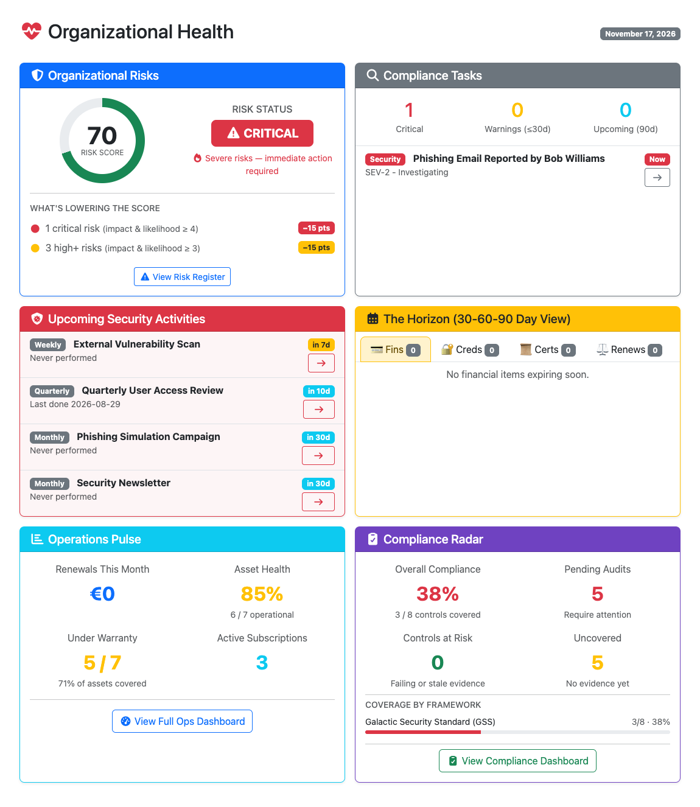
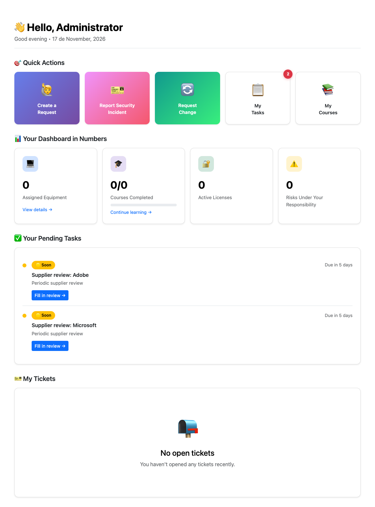

# Dashboard

OpsDeck has two dashboards:

- The **Health Dashboard** gives an organisation-wide view of risk, compliance and operations. It is the landing page (`/`) for users with the `health_dashboard` permission.
- **My Dashboard** is a personal page with your tasks, your tickets and the resources assigned to you. Every user has one. Users without the `health_dashboard` permission land here after login.

## Health Dashboard

Open it from **Health Dashboard** at the top of the sidebar, or by clicking the OpsDeck logo.

| Section | What it shows |
|---|---|
| **Organizational Risks** | A risk score from 0 to 100, which starts at 100 and drops 15 points per critical risk and 5 per high risk (open, not accepted residual risks). The **Risk Status** is critical when there are critical risks or active incidents, elevated when there are more than two high risks, and acceptable otherwise. **What's lowering the score** links to the matching risks in the register. |
| **Compliance Tasks** | Counts of critical items, warnings (due within 30 days) and upcoming items (within 90 days), followed by one prioritised list: active high-severity incidents, overdue maintenance, expired credentials and certificates first, then upcoming expirations by date. |
| **Upcoming Security Activities** | Recurring security activities due within 30 days, including overdue ones, with the date they were last done. |
| **The Horizon (30-60-90 Day View)** | Upcoming expirations in four tabs: **Fins** (payment methods), **Creds** (credentials), **Certs** (certificates) and **Renews** (subscriptions and licenses). |
| **Operations Pulse** | Renewal spend this month, asset health, assets under warranty and active subscriptions, with a link to the Ops & Finance dashboard. |
| **Compliance Radar** | Overall compliance, pending audits, controls at risk (failing or stale evidence), uncovered controls (no evidence yet), and coverage per framework, with a link to the Compliance Dashboard. |

## My Dashboard

Open it from the user menu in the top-right corner: **My Dashboard** (`/my-dashboard`).

### Quick Actions

| Action | Goes to |
|---|---|
| **Create a Request** | A new [service request](requests.md). |
| **Report Security Incident** | A new [security incident](incidents.md). |
| **Request Change** | A new [change](changes.md). |
| **My Tasks** | Your Pending Tasks, further down the page. The counter shows how many tasks you have. |
| **My Courses** | Your training. The counter shows courses you have not completed. |

### Your Dashboard in Numbers

Counters for your assigned equipment (assets and peripherals), completed courses, active licenses (with a warning for licenses expiring within 30 days), and open risks you own.

### Your Pending Tasks

Everything waiting for you, sorted by urgency:

- **Policy approvals**: active policy versions you have to acknowledge.
- **Courses** you have not completed and that are due within 30 days or overdue.
- **Credentials** expiring within 30 days.
- **Incidents, changes and requests assigned to you** that are still open: incidents not yet Resolved or Closed; changes not Completed, Failed or Cancelled; requests that are Pending, Triage or In Progress.
- **Supplier reviews** you own, directly or through a group, that are still open. See [Supplier Reviews](supplier-reviews.md).

Each task shows its urgency, based on its due date: **URGENT** when overdue, **Soon** when due within 7 days, **Pending** otherwise or when there is no due date. For changes the due date is the scheduled start; for requests and supplier reviews it is their due date. Incidents have no due date.

### My Tickets

Incidents you reported, and changes and requests you opened, each with a status badge. A ticket is listed while it is open and for 15 days after it is closed (incidents: Resolved or Closed; changes: Completed, Failed or Cancelled; requests: Completed, Closed or Cancelled).

My Tickets is about what **you opened**. Your Pending Tasks, the **My Tasks** counter and the notification bell only count what is **assigned to you**.

### My Resources

Tabs with what is assigned to you: **Equipment**, **Licenses**, **Services**, **Subscriptions** and **Risks**.

### Your Achievements

Badges for completed courses and other milestones.

## Notification bell

The bell in the top bar lists items that need action now. A dot on the bell means there is at least one:

- Policy acknowledgements past their deadline.
- Courses due within the next 3 days.
- Overdue maintenance on assets assigned to you.
- Open incidents, changes and requests assigned to you.

Risks are not included; they follow their own review cycle.
