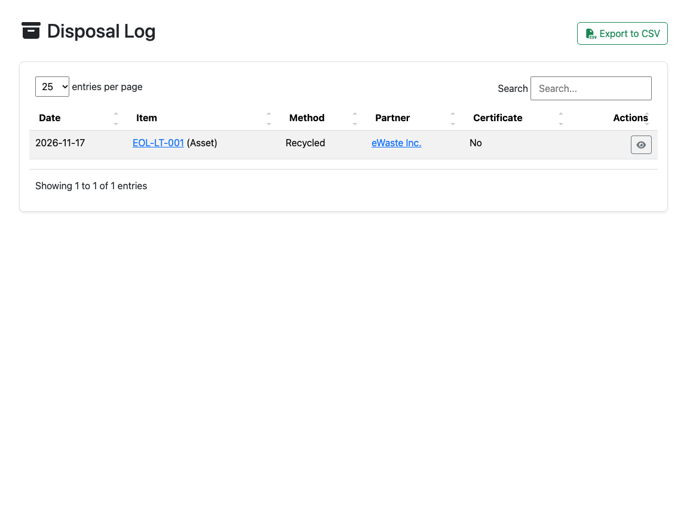
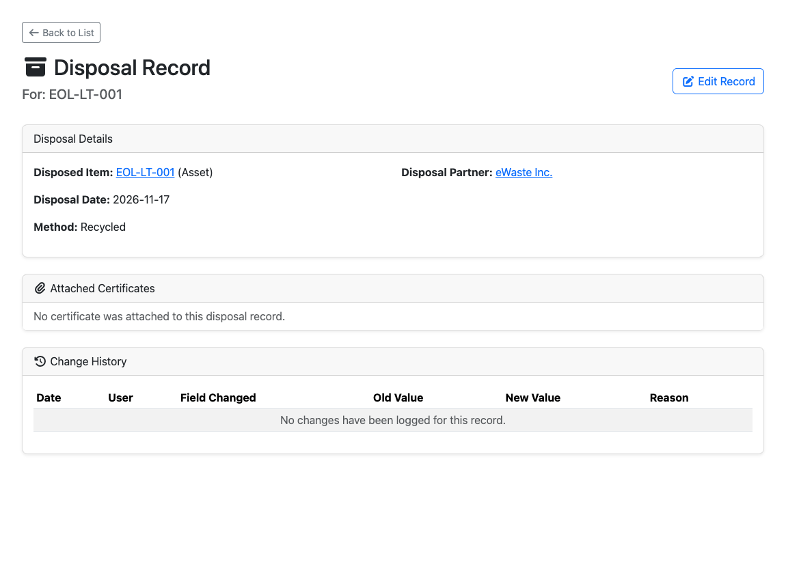

# Disposal

Record the end of life of hardware assets and peripherals, with method, disposal partner, certificates and a change history for audits.

Disposals are part of the **Operations** module.

## Recording a disposal

Disposals are started from the item being disposed:

1. Open the asset or peripheral.
2. Open the drop-down next to **Edit** and click **Record Disposal**.
3. Fill in the form:

    | Field | Description |
    |---|---|
    | **Date of Disposal** | Required. |
    | **Method** | Required: Recycled, Destroyed, Sold or Returned to Lessor. |
    | **Disposal Partner/Vendor** | Optional. A [supplier](suppliers.md) that handled the disposal, for example a certified e-waste company. |
    | **Notes** | Free text, for example the certificate number or the buyer. |

4. Click **Confirm Disposal & Archive**.

The item's status changes to **Disposed** and it is archived, so it no longer appears in the active asset or peripheral list.

!!! tip
    Before disposing of a device that stored data, log its data erasure from the same drop-down (**Log Data Erasure**). Erasures are listed in **Operations → Erasure Log**.

## Disposal log

**Operations → Disposals** (`/disposal/`) opens the **Disposal Log**: every disposal, newest first, with date, item, method, partner and a link to the disposal certificate if one is attached. Use **Export to CSV** to download it.

## Disposal record

The disposal record page shows:

- **Disposal Details**: the disposed item (linked to the asset or peripheral), date, method, disposal partner (linked to the supplier) and notes.
- **Attached Certificates**: certificates of destruction or recycling.
- **Change History**: every change made to the record after it was created.

The disposed asset or peripheral keeps a **View Disposal Record** link next to its status, and the rest of its history (purchase, assignments, maintenance) stays available. This supports audit requirements for asset lifecycle documentation (ISO 27001 A.8).

## Editing a disposal record

1. On the disposal record, click **Edit Record**.
2. Change the date, method, partner or notes, or attach a new certificate under **Attach New Certificate (Optional)**.
3. Enter a **Reason for Change** (required) and click **Save Changes**.

Each changed field is added to the **Change History** with the old value, new value, user, date and reason.
