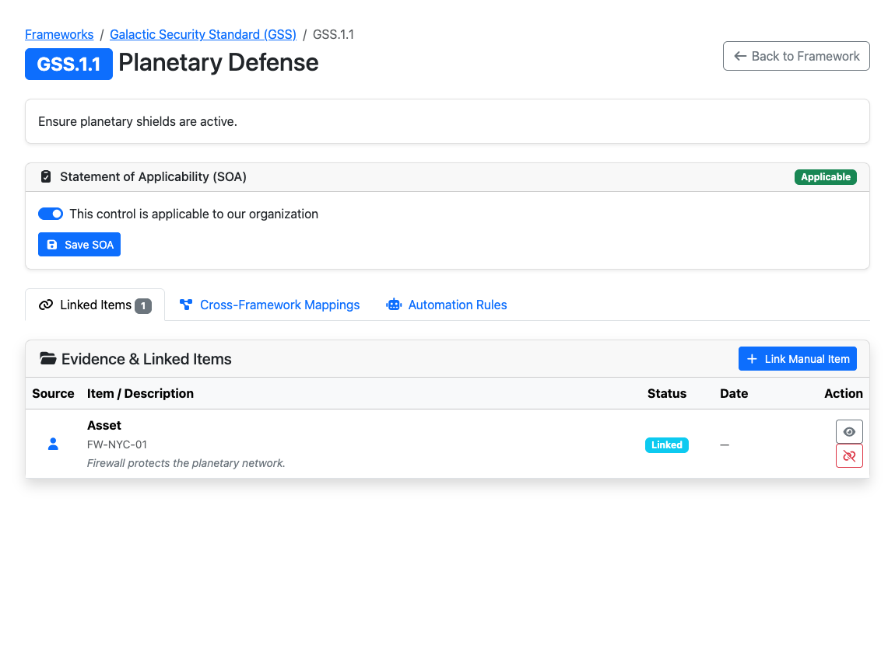

# Frameworks & Controls

OpsDeck's compliance engine is built around frameworks: structured collections of controls that define your regulatory or security requirements. Frameworks are under **Compliance → Frameworks** (`/frameworks/`) and require the `compliance` module; changing them requires write access.

## Built-in frameworks

The production seed (`flask seed-db-prod`) loads these built-in frameworks with their controls:

- ISO27001:2022
- SOC 2
- PCI DSS v4.0
- NIST CSF 2.0
- ENS (Spanish)
- DORA
- ITIL v4 and ITIL v3

Built-in frameworks cannot be renamed, deleted, or given extra controls. You can switch them between active and inactive, set the Statement of Applicability of their controls, and attach evidence and automation rules.

## Creating a custom framework

Create **custom frameworks** for internal policies, industry regulations, or client-specific requirements:

1. Go to **Compliance → Frameworks** and click **Create New Framework**.
2. Enter the **Framework Name**, an optional **Description** and **Link**, and leave **Active** ticked to use it in the dashboard and in new audits.
3. Click **Save Changes**. The edit page opens.
4. Under **Control Management**, click **Add Control** and enter the control identifier, **Control Name** and optional **Description**. Repeat for each control.

Custom frameworks can be deleted from the **Danger Zone** on their edit page.

Inactive frameworks are hidden from the [Compliance Dashboard](compliance.md) and cannot be chosen for new audits. Existing audits of an inactive framework are kept.

## Framework controls

Each control represents a single requirement:

- **Control ID** — control number (for example A.8.1, CC6.1).
- **Name** — short description.
- **Description** — full requirement text.

The framework page lists its controls. A control marked as not applicable shows an **N/A** badge, and a control with cross-framework mappings shows a link badge with the number of mappings.

## Control detail

Click a control to open its detail page. It has these sections:

| Section | Purpose |
|---|---|
| **Statement of Applicability (SOA)** | Whether the control applies, and why not |
| **Evidence & Linked Items** | Manual evidence (**Link Manual Item**) and the latest automated evidence |
| **Cross-Framework Mappings** | Controls in other frameworks that cover the same requirement; add them under **Add Mapping** |
| **Automation Rules** | Rules that check for recent evidence automatically |

## Mapping controls to evidence

Controls are connected to evidence in two ways:

- **Manual evidence** — click **Link Manual Item** on the control to link a policy, documentation page, service, or external link, with a description. You can also link from the other side: many records (assets, suppliers, policies, subscriptions and others) have a **Compliance Links** card where **Add Link** connects them to a control. See [Compliance Dashboard](compliance.md#evidence-linking).
- **Automation rules** — see below.

## Automation rules

An automation rule makes a control's status depend on evidence that OpsDeck already records. Click **Add Automation Rule** on the control detail page and set:

| Field | Meaning |
|---|---|
| **Rule Name** | Label for the rule |
| **Frequency (Days)** | How often the evidence must occur (default 90) |
| **Grace Period (Days)** | Extra days before the control turns non-compliant (default 7) |
| **Evidence Source** | Security Activity Executions, Communication Campaigns, Maintenance Logs, BCDR Test Logs, Onboarding Processes, Offboarding Processes, Supplier Security Assessments, or Risk Assessments |

Depending on the source, you can narrow it to a security activity, campaign tags, a maintenance event type or tags, a BCDR plan, or a user tag. For supplier security assessments, the **Which suppliers** option decides whether any supplier's latest review counts or whether every active (critical) supplier must be reviewed; see [Supplier Reviews](supplier-reviews.md#compliance-evidence).

The rule is **compliant** when the latest evidence is within the frequency, **warning** during the grace period, and **non-compliant** after it or when there is no evidence.

## Statement of Applicability (SoA)

For ISO 27001 and similar standards, the Statement of Applicability documents which controls are in scope and which are excluded, with a justification. To set it:

1. Open the control's detail page.
2. In the **Statement of Applicability (SOA)** card, untick **This control is applicable to our organization**.
3. Enter the **Justification (required when not applicable)**.
4. Click **Save SOA**.

The card header shows **Applicable** or **Not Applicable**. Ticking the box again clears the justification.

What applicability changes:

- On the framework page, the control gets an **N/A** badge.
- On the [Compliance Dashboard](compliance.md), the control shows as **N/A** and is counted under Not Applicable instead of being evaluated.
- New audits copy each control's applicability and justification, and items for non-applicable controls start with status **Not Applicable**. See [Audit Snapshots](audits.md#statement-of-applicability-in-new-audits).

The SoA document itself is produced per audit: the report in the audit's **Export Defense Pack** contains a Statement of Applicability table. See [Exporting for auditors](audits.md#exporting-for-auditors).
