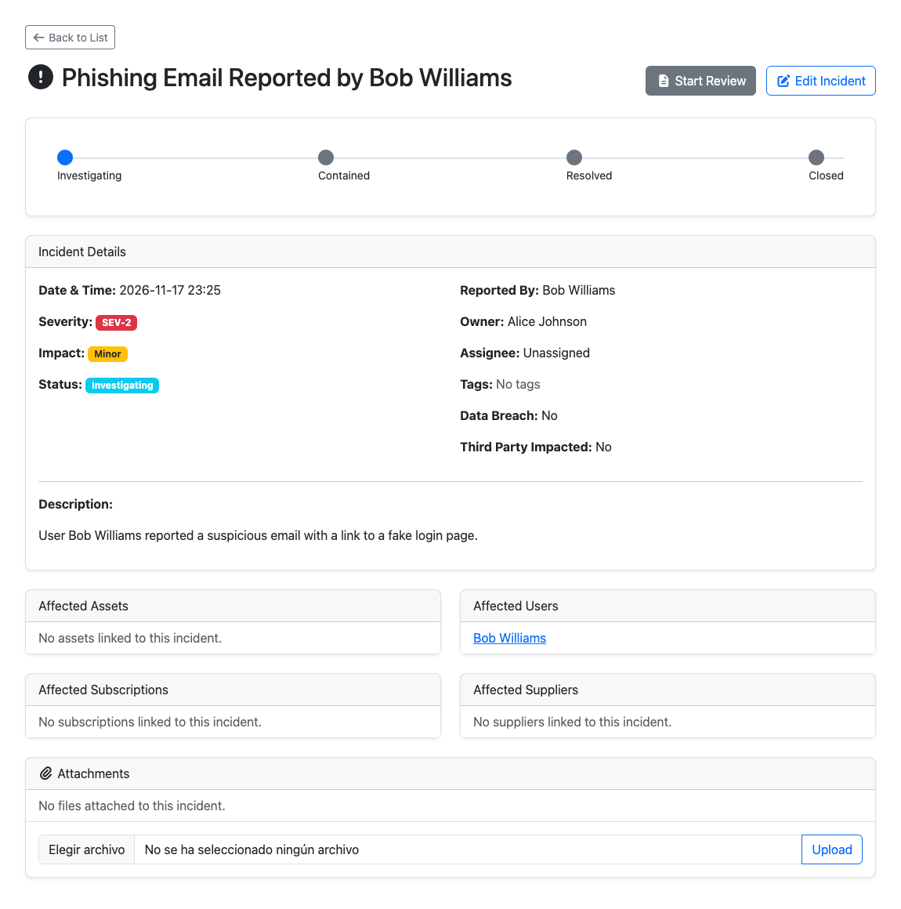

# Security Incidents

The incident management module tracks security events from initial report through investigation, resolution and post-incident review.

Open the module from **Operations → Incidents** (`/compliance/incidents`). Incidents belong to the `operations` permission module: read access lets you view incidents, write access is needed to log and edit them.

## Reporting an incident

1. Navigate to **Operations → Incidents**, or click **Report Security Incident** in the Quick Actions of [My Dashboard](dashboard.md#my-dashboard).
2. Click **Log New Incident**.
3. Fill in the form:

    | Field | Description |
    |---|---|
    | **Title** | Required. |
    | **Description** | Required. What happened. |
    | **Date & Time of Incident** | Required. When it happened. |
    | **Status** | See [Statuses](#statuses). |
    | **Severity** | SEV-0 (Critical), SEV-1 (High), SEV-2 (Medium) or SEV-3 (Low). Default: SEV-3. |
    | **Impact** | Minor, Moderate, Significant or Extensive. |
    | **Did this incident involve a data breach?** | Checkbox. |
    | **Was a third party (customer, supplier) impacted?** | Checkbox. |
    | **Owner** | The person accountable for the incident. |
    | **Assignee** | The person investigating it. |
    | **Tags** | Optional labels. |
    | **Affected Assets / Users / Subscriptions / Suppliers** | What the incident touched. |

4. Click **Save Incident**. You are recorded as the reporter.

## Statuses

| Status | Meaning |
|---|---|
| **Investigating** | The incident is being analysed. |
| **Contained** | The impact is under control, but the cause is not yet fixed. |
| **Resolved** | The cause is fixed. |
| **Closed** | Work is finished. OpsDeck records the resolution date. |

Change the status with **Edit Incident**.

## Incident detail

The detail page shows:

- A **status timeline** across the top: Investigating, Contained, Resolved, Closed.
- The incident's fields and the affected assets, users, subscriptions and suppliers.
- **Attachments**: upload evidence such as logs, emails or screenshots.
- Compliance links to framework controls.

## Finding incidents

The list (`/compliance/incidents`) shows date, title, severity, impact, status, tags, owner and assignee, newest first. Use the **Filter** menu to show one status (Investigating, Contained, Resolved or Closed), or add `?status=` to the URL. Click **Export to CSV** to download the table.

Incidents **assigned to you** that are not Resolved or Closed appear in **Your Pending Tasks** on My Dashboard and in the notification bell. Incidents **you reported** appear in **My Tickets**. See [Dashboard](dashboard.md#my-dashboard).

## Post-incident review

After the incident is handled:

1. On the incident detail page, click **Start Review** (or **View/Edit Review** if one exists).
2. Fill in the sections:

    | Section | Question it answers |
    |---|---|
    | **Summary / Executive Summary** | What happened, in short. |
    | **Lead-up** | What happened before? |
    | **Fault** | What was the root cause? |
    | **Impact Analysis** | What was affected? |
    | **Detection** | How did we find out? |
    | **Response** | What did we do? |
    | **Recovery** | How did we recover? |
    | **Lessons Learned** | What will we do differently? |

3. Click **Save Review**.
4. Add entries to the **Timeline of Events**: a date and time plus a description, then **Add Event**. Drag entries to reorder them, or delete them.
5. When the review is final, click **Finalize Report**. The review becomes read-only and **Export PDF** becomes available. Use **Unlock for Editing** to make further changes.

## Linking incidents

Incidents can be linked to:

- **Compliance controls**: incident handling is evidence that a control works.
- **Assets, users, subscriptions and suppliers**: the affected items.
- **Risks**: a risk can list an incident among its affected items.
- **UAR findings**: a finding from a user access review can be promoted to an incident.

## API

`POST /api/v1/incidents` creates an incident, or updates the existing one with the same `external_ref`. See [REST API](api.md).
