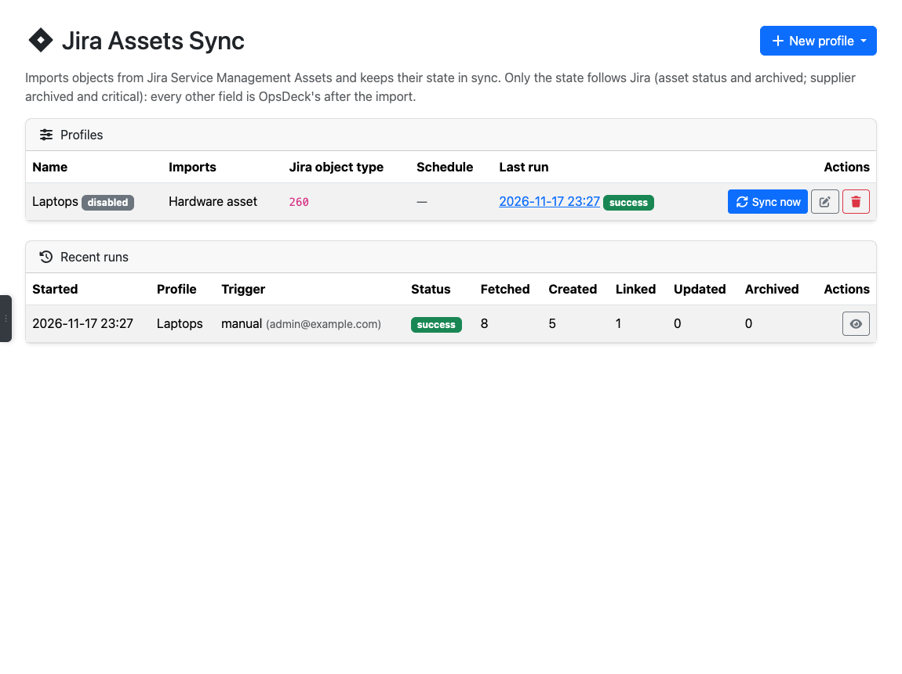
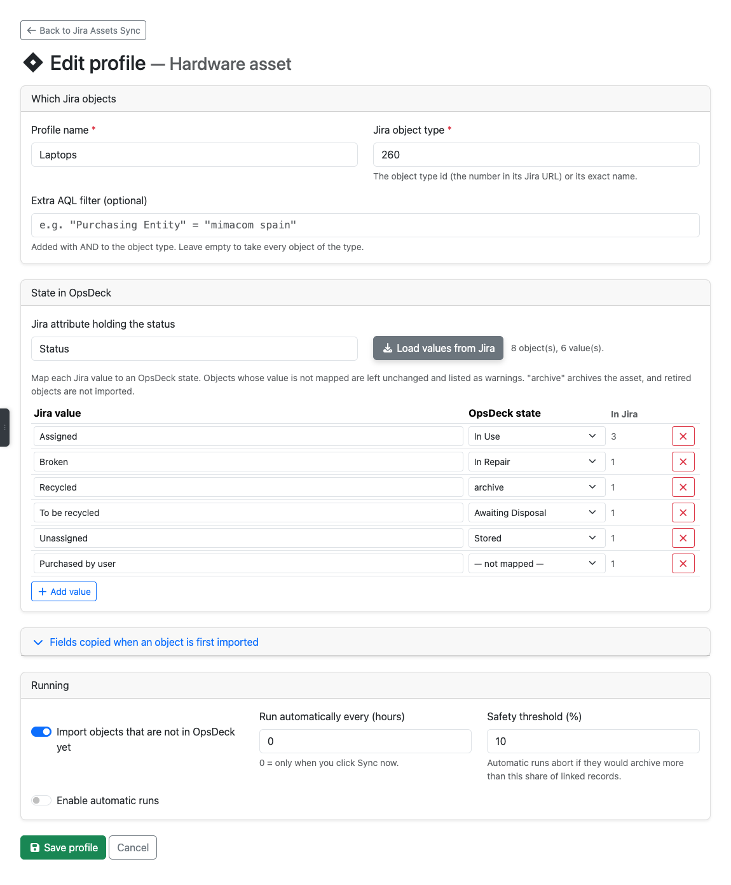
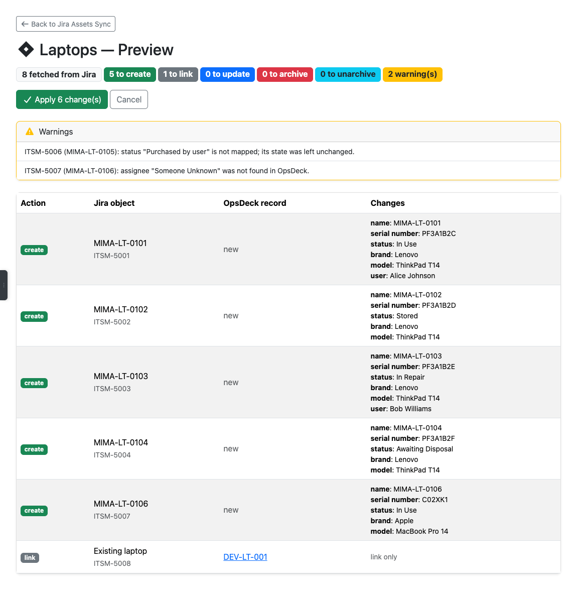

# Jira Assets Sync

If your organization keeps its inventory in **Jira Service Management Assets**, OpsDeck can import it and keep it up to date. The sync is **one-way** and deliberately narrow:

- Objects you select are **imported once** as OpsDeck hardware assets or suppliers.
- After that, **only their state follows Jira**: asset status and archived flag, supplier archived and critical flags.
- Every other field belongs to OpsDeck, so you can work on the records in OpsDeck without Jira overwriting your changes.

The sync is under **Settings → Jira Assets Sync** and requires write access to the `settings` module.



## Before you start

The sync uses the credentials of the **Atlassian API connector** (see [API Connectors](connectors.md)): the site URL, an email and an API token. The account needs read access to the Assets object schemas you want to import.

- The site URL must be `https://<your-site>.atlassian.net`.
- OpsDeck reads the Assets workspace ID from the site, then queries the Assets REST API at `https://api.atlassian.com/jsm/assets/workspace/<id>/v1`.

## Profiles

A **profile** says which Jira objects to import and what they become in OpsDeck. Create one with **New profile → Hardware assets** or **New profile → Suppliers**.



| Setting | Description |
|---|---|
| **Jira object type** | The object type ID (the number in its Jira URL, for example `260`) or its exact name (for example `Laptop`). |
| **Extra AQL filter** | Optional. ANDed with the object type, for example `"Purchasing Entity" = "mimacom spain"`. |
| **Jira attribute holding the status** | The attribute whose value decides the OpsDeck state. Defaults to `Status` for assets and `Active contract` for suppliers. |
| **Status map** | Maps each Jira value to an OpsDeck state. For assets: *In Use*, *Stored*, *In Repair*, *Awaiting Disposal* or *archive*. For suppliers: *active* or *archive*. |
| **Fields copied when an object is first imported** | The Jira attribute read for each field. The defaults match common attribute names; leave a field empty to skip it. |
| **Import objects that are not in OpsDeck yet** | Off: the profile only links and updates existing records. |
| **Run automatically every (hours)** | `0` means the profile only runs when you click **Sync now**. |
| **Safety threshold** | Automatic runs abort if they would archive more than this percentage of linked records. |

Once the profile is saved, **Load values from Jira** lists every value of the status attribute in use, with the number of objects that have it. Use it to complete the status map.

### What is imported

| Target | Fields copied on import | Kept in sync afterwards |
|---|---|---|
| **Hardware assets** | Name, serial number, brand and model (created if they don't exist), assignee, order date (as purchase date) | Status, archived |
| **Suppliers** | Name, website, email, phone, owner (for example the supplier relationship manager), critical flag | Archived, critical |

People named in Jira (an assignee or a supplier relationship manager) are matched to OpsDeck users by email, or by full name when exactly one user has that name. Synchronising your users from [Microsoft Entra ID](entra-id.md) first makes these matches reliable.

### Matching existing records

Before creating anything, OpsDeck **links** existing records to their Jira object, so nothing is imported twice:

- **Assets** are matched by serial number.
- **Suppliers** are matched by name. Two OpsDeck suppliers with the same name are skipped with a warning.

## Running a sync

**Sync now** fetches the objects from Jira and shows a **preview**. Nothing changes until you click **Apply**.



| Action | Meaning |
|---|---|
| **create** | A new OpsDeck record will be imported. |
| **link** | An existing record will be bound to its Jira object. |
| **update** | The status (or the critical flag) of a linked record changes. |
| **archive / unarchive** | A linked record is archived or restored. |

The rules that keep the sync safe:

- Objects whose status maps to **archive** (for example recycled or stolen laptops) are **not imported**.
- A status value that is **not mapped** leaves the record unchanged and appears as a warning.
- A linked record whose Jira object **no longer matches** the profile is reported, never archived: the query may simply have been narrowed.
- If Jira or OpsDeck changed between the preview and **Apply**, the run is refused and you are asked to preview again.
- Asset status and archive changes are written to the asset's history, and every change is recorded in the audit log.

Every run, manual or automatic, is kept in **Recent runs**, with what it changed and its warnings.

### Scheduled runs

Profiles with **Run automatically every (hours)** set are checked every 15 minutes and run when they are due. A scheduled run that would archive more than the profile's safety threshold **aborts without changes** and emails the administrators (or the notification recipient).

### Command line

```bash
flask jira-assets-sync --dry-run
flask jira-assets-sync --profile Laptops
```

Without `--profile`, every enabled profile runs. `--force` applies even above the safety threshold.
