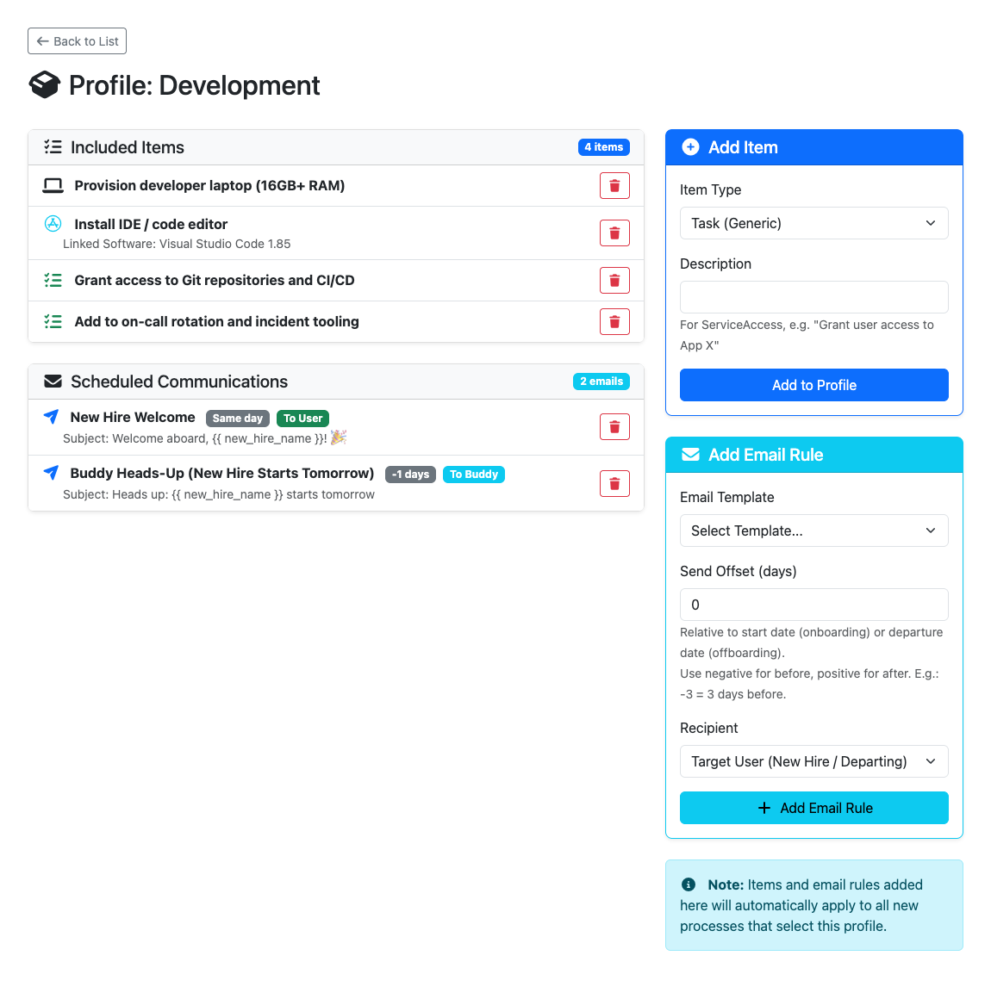
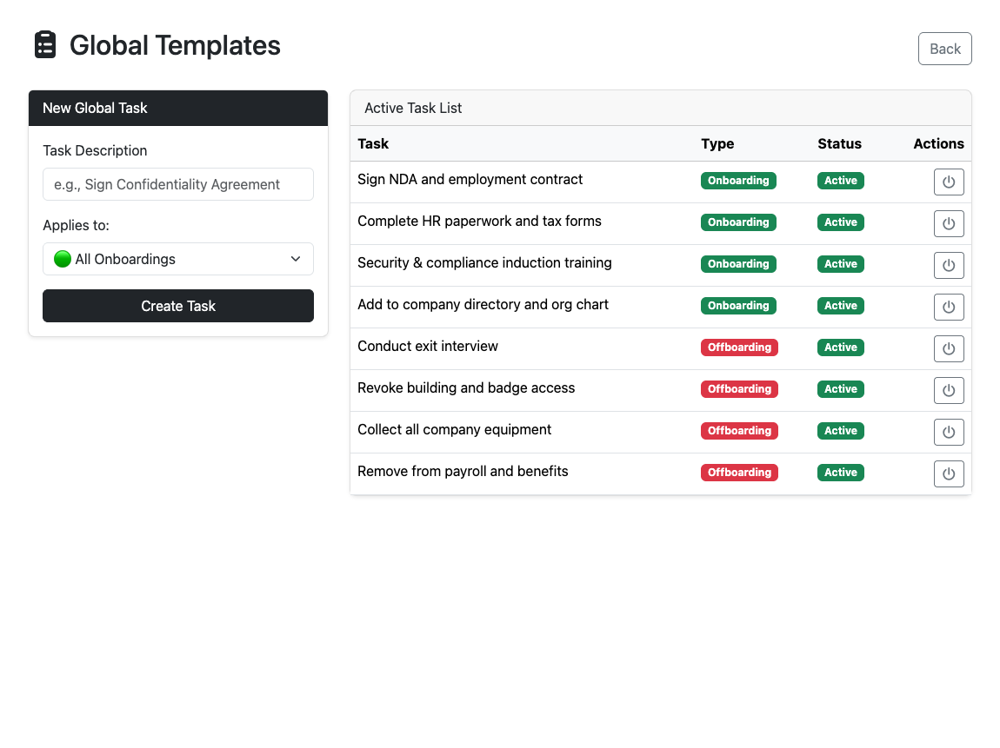

# Onboarding & Offboarding

Run employee onboarding and offboarding as checklists: OpsDeck builds the list of tasks from role profiles, global checklists and what the person owns, tracks progress, and schedules the related emails.

These features are part of the **HR & People** module. The menu has:

| Menu item | What it is |
|---|---|
| **HR Dashboard** | Onboardings and offboardings in progress, with their progress. |
| **New Onboarding** / **New Offboarding** | Start a process. |
| **Role Profiles** | Reusable sets of onboarding items per role. Needs write access. |
| **Global Checklists** | Tasks added to every onboarding or every offboarding. Needs write access. |
| **History** | All past and current processes. |

## Role profiles

A role profile defines what a new hire in a given role needs, for example *Development* or *Finance*.

1. Navigate to **HR & People → Role Profiles**.
2. Under **New Profile**, enter a **Profile Name** and **Description** and click **Create Profile**.
3. Open the profile and use **Add Item** to add what the role needs:

    | Item Type | Links to | When the onboarding runs |
    |---|---|---|
    | **Task (Generic)** | Nothing | A manual checklist task. |
    | **Software Provisioning** | Software | A task to provision the software. |
    | **Hardware Provisioning** | Nothing | A task to prepare hardware. |
    | **Service Access** | A business service | Checking the task off adds the new user to the service's access list. |
    | **Subscription Access** | A subscription | An action adds the new user to the subscription. |
    | **Course Assignment** | A training course | An action enrolls the new user in the course. |

    The description is filled in for you when you link an item; you can write your own.

4. Optionally, under **Add Email Rule**, schedule emails for every onboarding that uses the profile: pick an **Email Template**, a **Send Offset (days)** relative to the start date (negative for before, e.g. -3 = 3 days before) and a **Recipient** (Target User, Manager, Buddy or Personal Email).

## Global checklists

**HR & People → Global Checklists** holds tasks that apply to every process of a type, for example "Sign NDA and employment contract" for all onboardings or "Conduct exit interview" for all offboardings. Enter the **Task Description**, choose **Applies to** (All Onboardings or All Offboardings) and click **Create Task**. Deactivate a task to stop adding it to new processes.

## Starting an onboarding

1. Navigate to **HR & People → New Onboarding**.
2. Fill in:
    - **Employee Name (New Hire)**.
    - **Target Email** (optional): used when the user account is created.
    - **Personal Email** (optional): for emails sent before the corporate account exists.
    - **Start Date**.
    - **Assign Role Profile**, or none for global tasks only.
    - **Assign Manager** and **Assign Buddy** (optional).
3. Click **Generate Checklist**.

The checklist contains, in order: a task to create the user account, the active global onboarding tasks, the role profile's items, and meeting tasks with the manager and buddy. Email rules from the role profile are scheduled and shown in the **Email Timeline**, where you can send an email now or cancel it.

## Starting an offboarding

1. Navigate to **HR & People → New Offboarding**.
2. Select the user and their **Last Day**.
3. Optionally choose **Transfer ownership to**: a user who takes over the leaver's risks, service ownerships and credentials immediately.
4. Click **Generate Offboarding Checklist**.

The checklist is built from what the user has: assets and peripherals to collect, licenses to revoke, subscriptions they own or have access to, payment methods, risks and services they own, services they have access to, credentials they own, and the active global offboarding tasks. You are recorded as the responsible manager.

### Transferring ownership

If you did not choose a transfer user when starting the offboarding, reassign ownership from the checklist:

- **Risks**: click **Transfer** next to the risk and choose the new owner.
- **Service ownership**: click **Transfer** next to the service.
- **Credentials**: click **Reassign** next to the credential.

The task is checked off as soon as the transfer is saved. Other tasks have their own actions, for example returning an asset or peripheral to a location, or revoking access to a service or subscription.

## Working the checklist

The process page shows the progress as a percentage, the **Task Checklist**, a **Details** card and the **Email Timeline**. Check tasks off as they are done.

Use **Edit** in the **Details** card to change the process details:

| Process | Editable details |
|---|---|
| Onboarding | Start Date, Personal Email, Target (Corporate) Email, Hiring Manager, Onboarding Buddy, **Notes** |
| Offboarding | Departure Date, Responsible Manager, **Notes** |

Notes are free text shown in the **Details** card, for example to record why a task was skipped.

## Completing a process

Click **Complete Process**. You can complete a process below 100%: OpsDeck asks for confirmation and tells you how many items are still pending.

- Completing an **onboarding** marks it Completed.
- Completing an **offboarding** marks it Completed, sets the departure date to today, and **archives the user**.

Completed processes are listed in **HR & People → History**.
