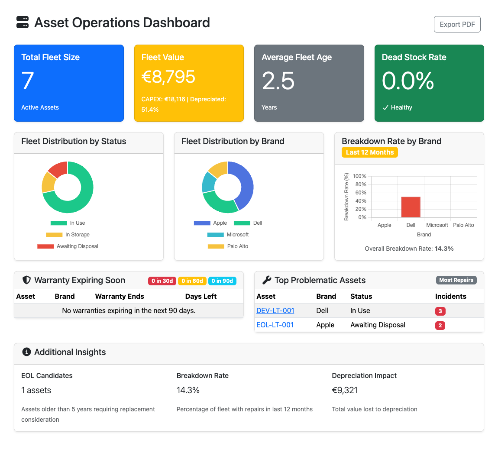
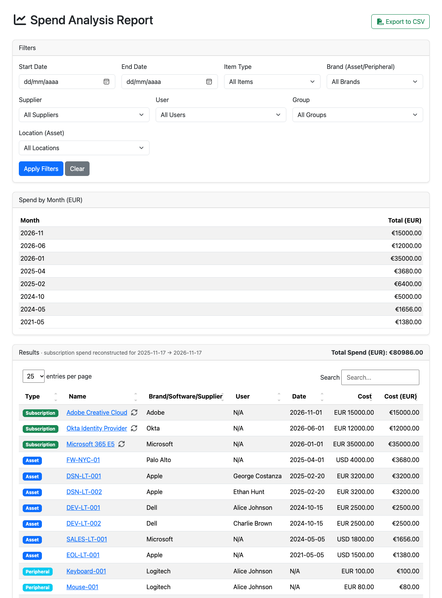

# Reports & Search

OpsDeck includes built-in reports for assets, spend and depreciation, a quick search box in the top bar, and a Universal Search page with filters.

## Built-in reports

| Report | Menu path | URL | Permission |
|---|---|---|---|
| Asset Operations Dashboard | **Operations → Asset Reports** | `/reports/assets-dashboard` | `core_inventory` (read) |
| Spend Analysis | **Finance → Spend Analysis** | `/reports/spend-analysis` | `finance` (read) |
| Depreciation Report | **Finance → Depreciation** | `/reports/depreciation` | `core_inventory` (read) |
| Subscription Reports & Analytics | No menu entry | `/reports/subscription-reports` | `core_inventory` (read) |
| Asset Reports & Analytics | No menu entry | `/reports/asset-reports` | `core_inventory` (read) |

Amounts added up across items are converted to EUR using the rates under **Finance → Exchange Rates**.

### Asset Operations Dashboard

A summary of all non-archived assets:

- **KPIs** — Total Fleet Size, Fleet Value (purchase cost and current value, depreciated linearly over 4 years), Average Fleet Age, and Dead Stock Rate (share of assets with status In Stock).
- **Charts** — Fleet Distribution by Status, Fleet Distribution by Brand, and Breakdown Rate by Brand (assets with a Repair maintenance log in the last 12 months).
- **Warranty Expiring Soon** — assets whose warranty ends within 30 days, plus counts for 60 and 90 days.
- **Top Problematic Assets** — the assets with the most maintenance logs.
- **Additional Insights** — end-of-life candidates (assets older than 5 years) and the overall breakdown rate.

Click **Export PDF** to download the dashboard as `assets_dashboard.pdf`.

### Spend Analysis

Lists what was spent on assets, peripherals, standalone licenses and subscriptions, newest first, with a **Spend by Month (EUR)** table and a **Total Spend (EUR)**.

| Filter | Applies to |
|---|---|
| **Start Date**, **End Date** | Purchase date of assets, peripherals and licenses; billing dates of subscriptions |
| **Item Type** | All Items, Assets Only, Peripherals Only, Licenses Only (Standalone), Subscriptions Only (Recurring) |
| **Brand** | Assets and peripherals |
| **Supplier** | All item types (licenses through their purchase) |
| **User** | Assigned user; for subscriptions, any of the subscription's users |
| **Group** | Same as User, for every active member of the group |
| **Location** | Assets only |

How the figures are built:

- **One-off items** (assets, peripherals, and licenses that are not part of a subscription and have a cost) count once, on their purchase date, at their purchase cost.
- **Subscriptions** count once per billing date in the period. Each charge is valued at the price and seat count in effect on that date, taken from the subscription's cost history, so past price or seat changes are reflected. If no date range is set, subscription spend covers the last 12 months up to today; the period used is shown next to **Results**. One-off items have no default range: without dates, all of them are included.
- Setting a **Brand** or **Location** filter leaves subscriptions out, since those filters do not apply to them.

Click **Export to CSV** to download the results table as `spend-analysis.csv`.

### Depreciation Report

Calculates the current book value of assets and peripherals that have a cost and a purchase date.

- **Depreciation Period (Years)** (default 5) and **Depreciation Algorithm** (Linear or Declining Balance) control the calculation.
- Filter by purchase date range, item type (Assets & Peripherals, Assets Only, Peripherals Only), brand, supplier, user, group and location.
- **Currency** shows the table in one currency instead of each item's original currency.
- Charts show **Total Value vs. Depreciated Value (EUR)** and **Depreciation by Location (EUR)**.

Click **Export to CSV** to download the table as `depreciation.csv`.

!!! note
    The Depreciation entry sits in the Finance menu, but the report requires read access to the `core_inventory` module.

### Subscription and asset analytics

Two older chart pages are still available by URL:

- **Subscription Reports & Analytics** (`/reports/subscription-reports`) — spending by supplier for a selected year, subscriptions by type, spending per month (last 12 months) and per year (last 5 years), and an upcoming renewal cost forecast. Only auto-renewing subscriptions are counted, at their current cost.
- **Asset Reports & Analytics** (`/reports/asset-reports`) — assets by brand, supplier and status, and warranty status (active or expired).

## Search

### Quick search

The search box in the top bar (**Search assets, users, risks...**) shows matches as you type (at least 2 characters, up to 5 per type) across subscriptions, assets (name or serial number), suppliers, contacts, purchases and peripherals. Click a result to open it. Only types from modules you can read are searched.

### Universal Search

The Universal Search page (`/search/`) searches more fields and lets you filter results:

1. Enter a query. It matches names, descriptions, serial numbers, asset tags, notes, emails and similar text fields, depending on the entity type.
2. Results are grouped by entity type with a count for each.
3. Narrow the results with the **Entity Types** checkboxes, **Date Range**, **Status** and **Severity** filters.
4. Click any result to open its detail page.

Searchable entity types are assets, users, UAR executions, UAR findings, compliance controls, security incidents, suppliers, subscriptions and business services.

Results and facet counts only include entity types from modules you can read. For example, a user without the `compliance` module gets no UAR findings or controls in the results, and no status or severity counts for them.
