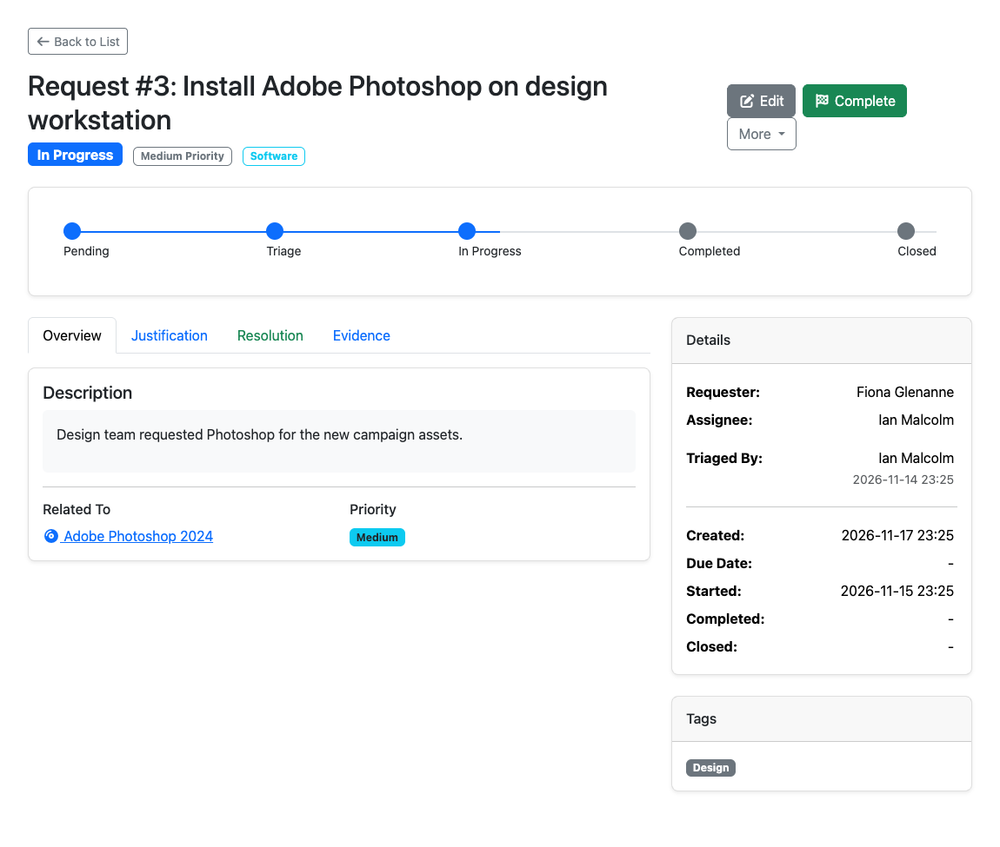

# Service Requests

Service requests track things people ask IT for: access, hardware, software, information. Each request goes through a service-desk workflow from submission to closure, with timestamps for every step.

Open the module from **Operations → Requests** (`/requests/`). Requests belong to the `operations` permission module: read access lets you view requests, write access is needed to create, edit and move them through the workflow.

## Creating a request

1. Click **New Request** on the list, or **Create a Request** in the Quick Actions of [My Dashboard](dashboard.md#my-dashboard).
2. On the **General Information** tab, fill in:

    | Field | Description |
    |---|---|
    | **Title** | Required. |
    | **Description** | What is being requested. Markdown is supported. |
    | **Related To** | Optional target: **Service**, **Asset** or **Software**, then pick the item. |
    | **Tags** | Optional labels. |
    | **Request Type** | General, Access, Hardware, Software or Information. Default: General. |
    | **Priority** | Low, Medium, High or Critical. Default: Medium. |
    | **Due Date** | Optional date and time. |
    | **Assignee** | The person who will fulfil the request. |

3. On the **Justification & Resolution** tab, enter the **Justification**: why the request is needed.
4. Click **Create Request**.

You are recorded as the requester. New requests start in **Pending**.

## Workflow

| Status | Meaning | Button to move on |
|---|---|---|
| **Pending** | Submitted, not yet looked at. | **Send to Triage** |
| **Triage** | Being assessed. OpsDeck records who triaged it and when. | **Start Work** |
| **In Progress** | Being fulfilled. | **Complete** |
| **Completed** | Fulfilled, waiting for confirmation. | **Close** |
| **Closed** | Done. Final status. | — |
| **Cancelled** | Withdrawn. Final status. | — |

Each step can only be taken from the status before it; for example, work cannot start on a request that has not been through triage. To cancel, open **More → Cancel Request**. Cancelling is possible from Pending, Triage or In Progress.

Requests can be edited until they reach Completed, Closed or Cancelled. Record how the request was fulfilled in **Resolution Notes** (**Edit → Justification & Resolution**) before you click **Complete**, because the request cannot be edited afterwards.

## Request detail

The detail page shows:

- A **status timeline** across the top: Pending, Triage, In Progress, Completed, Closed. Cancelled requests show a "This request was cancelled" badge instead.
- Tabs for **Overview**, **Justification**, **Resolution** and **Evidence**.
- The people involved (requester, assignee, triaged by) and the dates (created, due, started, completed, closed).

On the **Evidence** tab you can upload files, such as approval emails or screenshots, as proof that the request was handled. Uploading requires write access.

## Finding requests

The list shows ID, title, type, priority, status, due date, requester and assignee, newest first. Use the **Filter** menu to show one status. You can also filter by URL parameters, and combine them:

| Parameter | Example |
|---|---|
| `status` | `/requests/?status=In Progress` |
| `type` | `/requests/?type=Access` |
| `priority` | `/requests/?priority=Critical` |

## Where requests appear

- Requests **assigned to you** that are Pending, Triage or In Progress appear in **Your Pending Tasks** on My Dashboard and in the notification bell.
- Requests **you opened** appear in **My Tickets** on My Dashboard while open, and for 15 days after they are completed, closed or cancelled.

See [Dashboard](dashboard.md#my-dashboard).

## API

Requests can be created and read through the REST API:

- `GET /api/v1/requests` lists requests (`limit` and `offset` parameters).
- `GET /api/v1/requests/<id>` returns one request.
- `POST /api/v1/requests` creates a request, or updates the existing one with the same `external_ref`. Use this to sync tickets from another tool. `requester` and `assignee` are matched by email or name; without a requester, the API token's user is used.

See [REST API](api.md) for authentication.
