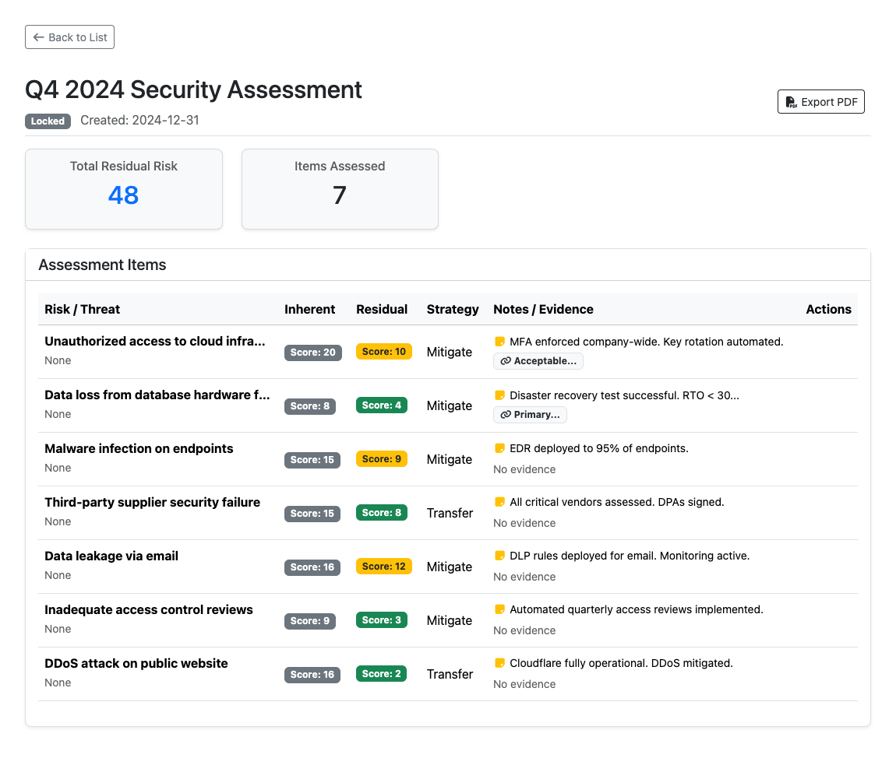

# Risk Assessment

A risk assessment is a point-in-time review of the risk register. It takes a snapshot of the open risks, lets you re-score their residual risk and attach evidence, and when locked can write the new scores back to the live register.

Risk assessments are under **Risk & Governance → Risk Assessments** (`/risk-assessments/`). They require the `risk_governance` module; creating, editing and locking require write access.

## Creating an assessment

1. Go to **Risk & Governance → Risk Assessments** and click **New Assessment**.
2. Enter an **Assessment Name** (for example "Q1 2026 Security Assessment").
3. Choose a **Snapshot Strategy**:
    - **Snapshot All Open Risks** (recommended) copies every risk in the register whose status is not Closed: description, threat type, categories, inherent and residual impact and likelihood, and treatment strategy.
    - **Start Empty** creates an assessment with no items.
4. Click **Create Assessment**. The assessment starts in **Draft**.

The items are copies: changing them does not change the live risks until you lock the assessment and choose to sync.

## Reviewing items

The assessment page shows the **Total Residual Risk** (sum of residual scores, where each score is impact × likelihood) and the number of **Items Assessed**, followed by the items table: Risk / Threat, Inherent, Residual, Strategy, and Notes / Evidence.

For each item, while the assessment is not locked:

- Click the edit button to update the **Mitigation Notes**, **Residual Impact (1-5)** and **Residual Likelihood (1-5)**.
- Click **Add Evidence** (the plus button) to either **Upload File** or **Link Object** (a policy, asset, documentation page, software, supplier or training course), with optional notes.
- Remove evidence with the delete button next to it.

## Locking an assessment

1. Click **Lock Assessment**.
2. In the dialog, decide whether to tick **Yes, update Residual Scores and Status**. The dialog lists the items whose residual score differs from the live risk.
3. Click **Lock Assessment** to confirm.

Locking is permanent: a locked assessment cannot be edited, and there is no unlock action. The total residual risk is stored at lock time.

If you ticked the sync option, each item that came from a live risk updates that risk:

| Result | Effect on the live risk |
|---|---|
| Residual score | Set to the assessment's residual impact and likelihood |
| Status (unless Closed or Accepted) | **Mitigated** if the score is below 5, **In Treatment** if 15 or more, otherwise **Assessed** |

## Exporting

Click **Export PDF** on the assessment page to download a **Risk Assessment Report** with an executive summary and the detailed list of assessed risks.

## Using assessments as compliance evidence

A compliance automation rule with the evidence source **Risk Assessments** uses the creation date of the most recent assessment (in any status) as evidence that the risk review happens on schedule. See [Frameworks & Controls](frameworks.md#automation-rules).

## Relationship to the risk register

Assessments read from and, optionally, write back to the [Risk Register](risk.md). Risks are created and managed in the register itself; an assessment does not create new risks.
