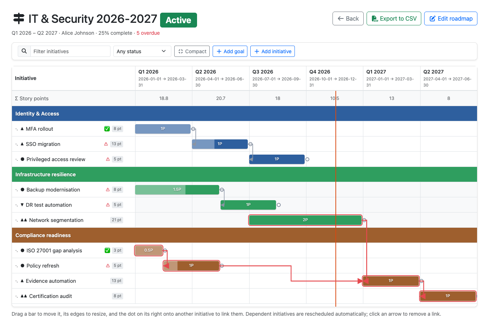
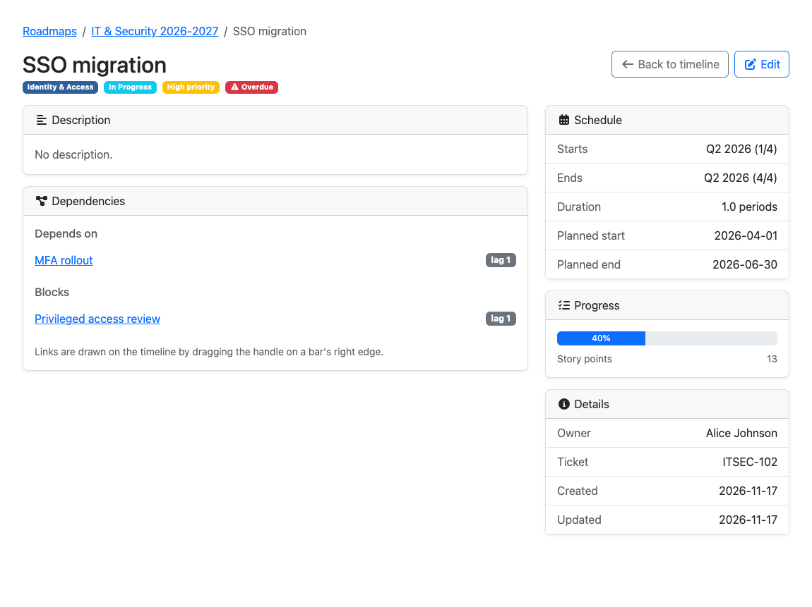

# Roadmaps

Roadmaps plan strategic work over time. A roadmap is split into **periods** (usually quarters), grouped into **goals** (swimlanes), and filled with **initiatives** (bars on a timeline). Initiatives can depend on each other, and OpsDeck reschedules dependent work when something moves.

Open the module from **Roadmaps → Roadmaps** (`/roadmaps/`). Access is controlled by the `roadmaps` permission module: read access shows the timeline, write access is needed to create, edit, move or delete anything.

## Roadmap list

The list shows every roadmap with its status, owner, timeline (first and last period), number of goals and initiatives, and overall progress. Filter by **Status** at the top, or click **Export to CSV** to download the list.

Overall progress is the average of the initiatives' progress, weighted by story points (initiatives without points count as 1 point).

## Creating a roadmap

1. Click **New Roadmap**.
2. Fill in the header fields:

    | Field | Description |
    |---|---|
    | **Name** | Required. |
    | **Description** | Free text. |
    | **Status** | `draft`, `active` or `archived`. |
    | **Owner** | The user accountable for the roadmap. |

3. Add the **periods**, the columns of the timeline, in order. Each period has a **Label** (for example `Q1 2027`) and optional **Start date** and **End date**. To add a whole year at once, enter the year and click **Add 4 quarters**; use **Add period** for a single row.
4. Click **Create Roadmap**.

A roadmap needs at least one period before initiatives can be placed on it. To change periods later, click **Edit roadmap** on the timeline. Removing or reordering periods shifts where existing initiatives sit, because initiatives are positioned relative to the periods.

To delete a roadmap, use the delete action in the list. This also deletes its periods, goals, initiatives and dependencies.

## The timeline

Open a roadmap to see its timeline. The header shows the status, date range, owner, overall progress and the number of overdue initiatives.

Each goal is a coloured swimlane, and each initiative is a bar under its goal. Each period is divided into **4 steps**, and bars snap to steps, so an initiative can start or end a quarter of the way through a period.

| Element | Meaning |
|---|---|
| Bar fill | The initiative's progress. |
| Bar text | Duration in periods, for example `1.5P`. |
| Priority icon | ▲▲ very high, ▲ high, ● medium, ▼ low, ▼▼ very low. |
| ✅ / ⚠ | Done / overdue (past its planned end date and not done). |
| `8 pt` | Story points. |
| Arrows | Dependencies, from predecessor to successor. |
| Red bars and arrows | The critical path. |
| **Today** line | The current date, when it falls inside a dated period. |
| **Σ Story points** row | Story points per period. An initiative spanning several periods is split across them in proportion to its length. |

### Toolbar

- **Filter initiatives**: search by name. Matches are highlighted.
- **Any status**: show only Planned, In progress or Done initiatives.
- **Compact**: denser rows. The setting is remembered in your browser.
- **Add goal** and **Add initiative** (write access only). Users without write access see a **Read only** badge.

### Goals

Click **Add goal** and enter a **Name** and a **Colour**. Use the **+** on a goal's header to add an initiative to it, and the **×** to delete the goal together with all its initiatives.

### Initiatives

Click **Add initiative**, choose the goal and enter a name. A new initiative starts on the first period; drag it into place afterwards.

With write access you can change an initiative directly on the timeline:

| Action | How |
|---|---|
| Move | Drag the bar. |
| Resize | Drag the bar's left or right edge. |
| Reorder within a goal | Drag the grip next to the name. |
| Move to another goal | Drag the grip onto another goal's row. |
| Link to another initiative | Drag the dot on the right of the bar onto the other initiative. |
| Remove a dependency | Click the arrow and confirm. |
| Delete | Click the **×** next to the name. |

Click an initiative's name to open its side panel. There you can edit name, status, priority, progress, story points, ticket reference and URL, the **Flag as new this cycle** checkbox and the description, see and remove its dependencies, and add a successor (**Add as successor**). Click **Save changes** to apply them, or **Open full details** to go to the initiative page.

## Initiative fields

| Field | Values |
|---|---|
| **Name** | Required. |
| **Status** | `planned`, `in_progress`, `done`. |
| **Priority** | `very_low`, `low`, `medium`, `high`, `very_high`. |
| **Progress (%)** | 0 to 100. |
| **Story points** | Whole number, 0 or more. Optional. |
| **Owner** | A user. Set on the initiative page. |
| **Ticket reference** | The key in your tracker, for example `ITSEC-102`. |
| **Ticket URL** | Link to the ticket. When both are set, the reference becomes a link. |
| **Flag as new this cycle** | Marks work added in the current planning cycle. |
| **Description** | Markdown is supported. |

Planned start and end dates are calculated from the bar's position and the period dates. You cannot edit them directly.

## Dependencies and rescheduling

Dependencies are **finish-to-start**: the successor starts after the predecessor ends. When you create a link, OpsDeck keeps the gap you drew between the two bars.

- When you move or resize an initiative, everything that depends on it is moved too, keeping each gap. A successor with several predecessors is placed after the one that ends **latest**.
- Moving a successor by hand redefines its gap to its predecessors.
- A link that would create a cycle is rejected with "That link would create a dependency cycle."
- If a dependent initiative does not fit before the end of the roadmap, OpsDeck shows a warning that it could not be scheduled after its dependencies. Add a period to make room.

The **critical path** is the chain of dependencies with no slack that leads to the initiative finishing last. Any delay on it delays the end of the roadmap.

## Initiative detail page

Each initiative has its own page at `/roadmaps/<roadmap id>/initiatives/<initiative id>`, which you can bookmark or share. It shows:

- The goal, status, priority, **New this cycle** and **Overdue** badges.
- The rendered Markdown description.
- **Depends on** and **Blocks**: its predecessors and successors.
- **Schedule**: start and end period, duration, planned start and end dates.
- **Progress** and story points.
- **Details**: owner, ticket link, created and updated dates.
- **Additional Properties**: custom field values, when custom fields are defined for roadmap initiatives.

Click **Edit** to change the initiative's fields, including the owner. **Back to timeline** returns to the roadmap.

## Exporting

Click **Export to CSV** on the timeline (`/roadmaps/<id>/export`) to download every initiative in timeline order. The file contains goal, initiative, status, priority, progress, points, start and end period, duration, planned start and end dates, overdue and new flags, ticket reference and URL, owner and description.
