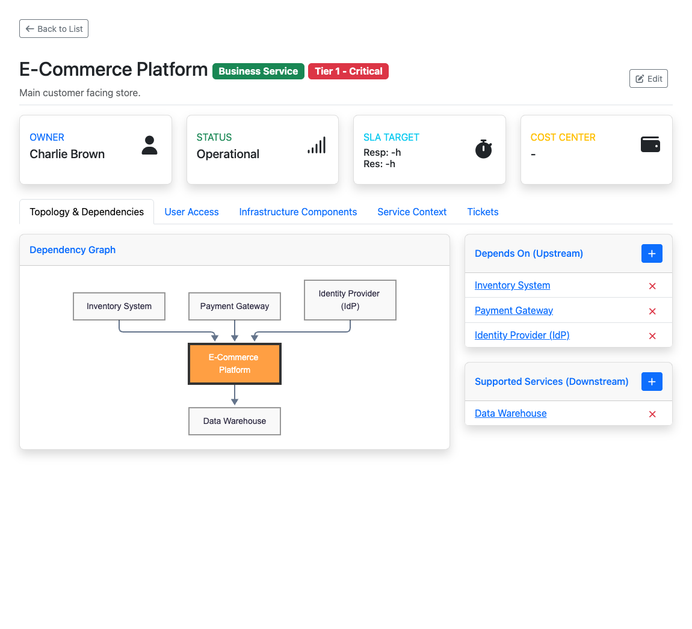
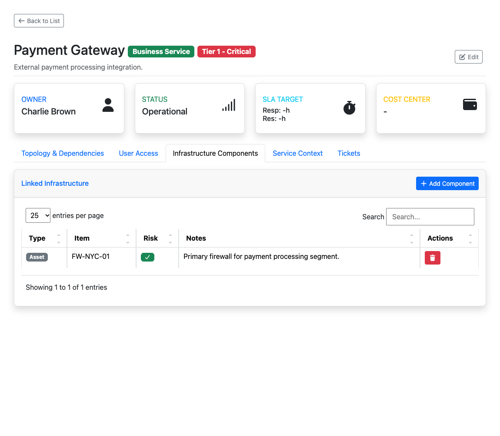

# Service Catalog

The service catalog maps the services your organization runs to the infrastructure, people and documents behind them, so you can see what a service depends on, who can use it, and what else is affected when something breaks.

Services are part of the **Core Inventory** module.

## Adding a service

1. Navigate to **Core Inventory → Services**.
2. Click **New Service**.
3. Fill in the fields below and save.

| Field | Description |
|---|---|
| **Service Name** | Required. |
| **Description** | What the service does. |
| **Category** | Application, Business Service, Infrastructure or Capability. Shown as a badge next to the name. |
| **Service Owner** | The user accountable for the service. |
| **Cost Center** | Optional. |
| **Criticality** | Tier 1 - Critical, Tier 2 - High or Tier 3 - Standard. |
| **Status** | Pipeline (planned or being built), Operational or Retired. |
| **SLA Response Target (Hours)** / **SLA Resolution Target (Hours)** | Optional service-level targets. |

The service list shows each service's owner, criticality, status and SLA targets.

## The service page

The top of the page shows the category and criticality badges, a **Risk** badge when the service has risk (see below), and cards for owner, status, SLA target and cost center. The rest is split into tabs.

### Topology & Dependencies

Services can depend on other services. A dependency is not a component: it links two services in the catalog.

- **Depends On (Upstream)**: services this service needs to work.
- **Supported Services (Downstream)**: services that need this one.

To add one, click the **+** button on either list, pick the **Service** and optionally a **Relationship Type** (Hosts, Authenticates, Provides Access, Stores Data, Processes Data, Monitors, Backs Up, Routes Traffic, Calls Api, Sends Data), then click **Add Dependency**. A service cannot depend on itself.

The **Dependency Graph** draws the full chain in both directions, including indirect dependencies: if Service A depends on Service B, which depends on Service C, all three appear. The current service is highlighted and other nodes are coloured by risk.

### User Access

Lists everyone who can use the service and where the access comes from:

| Access source | Meaning |
|---|---|
| **Direct** | Granted on the service itself, with **Add User** or **Add All**. |
| **Via Subscription** | The user has access to a subscription linked as a component. |
| **Via License** | The user holds a license linked as a component. |

Only direct access can be revoked here; inherited access is managed on the subscription or license.

### Infrastructure Components

The **Linked Infrastructure** list holds the building blocks of the service. Click **Add Component**, choose a **Component Type**, select the item, add optional **Notes**, and click **Link Component**.

| Component type | Links to |
|---|---|
| **Physical Asset** | A hardware [asset](assets.md), e.g. a server or firewall. |
| **Software** | A [software](software.md) entry. |
| **License** | A software license. |
| **Supplier** | A [supplier](suppliers.md) the service relies on. |
| **Subscription** | A [subscription](subscriptions.md), e.g. the SaaS plan behind the service. |
| **CMDB** | A configuration item from **Core Inventory → CMDB** (`/configuration/`). |

The **Risk** column shows the risk of each component. The service's **Risk** badge is the highest risk score among its components.

### Service Context

Links the service to the material that describes and protects it:

- **Documentation** and **External Links**.
- **Policies** that govern the service.
- **Security Activities** that protect it.
- **Files / Contracts**: uploaded files.
- **Certificates** and **Credentials** used by the service (see [Credentials](credentials.md)). When a linked certificate or credential expires within 30 days, the service list shows a warning icon next to the service.

### Tickets

**Associated Tickets** lists the changes linked to the service, newest first.

## Compliance links

At the bottom of the service page, **Compliance Links** connects the service to the framework controls it must satisfy.

## Impact analysis

When a component or an upstream service has a problem, open the affected service and check **Supported Services (Downstream)** and the dependency graph to see which services are affected. Use this to judge incident severity and change risk.
