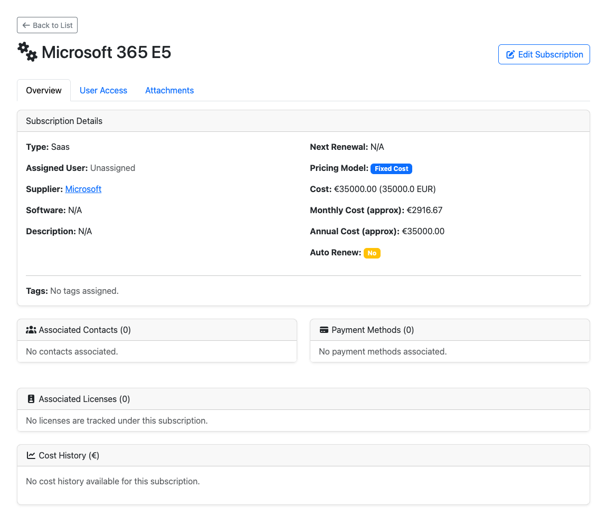

# Subscriptions

Track SaaS subscriptions, domains, certificates and other recurring costs, with renewal dates, per-user pricing, cost history and the list of users who have access.

Subscriptions are part of the **Core Inventory** module.

## Adding a subscription

1. Navigate to **Core Inventory → Subscriptions**.
2. Click **Add Subscription**.
3. Fill in the fields below and click **Save Subscription**.

| Field | Description |
|---|---|
| **Name** | Required. |
| **Type** | Required: Subscription, Contract, Domain or Certificate. |
| **Description** | Free text. |
| **Supplier** | Optional. The supplier you pay. |
| **Associated Software** | Optional link to a [software](software.md) entry. |
| **Budget** | Optional. The renewal date must fall inside the budget's validity period. |
| **Assigned User (Owner)** | Optional. Leave as *Unassigned (General Use)* for shared subscriptions. |
| **Associated Contacts** | Supplier contacts for this subscription. |
| **Payment Methods** | One or more payment methods. |
| **Initial Renewal Date** | Required. A date in the past is accepted: OpsDeck calculates the next renewal from it. |
| **Period Type** | Required: Monthly, Yearly or Custom. |
| **Period Value** | Number of periods between renewals, e.g. 1 for yearly, 90 for 90 days with a custom period. |
| **Advanced Monthly Renewal Day** | For monthly renewals: same day as the initial renewal, first day of the month, last day of the month, or a specific day. |
| **Pricing Model** | Required: **Fixed Cost** (total cost regardless of user count) or **Per User Cost** (cost multiplied by the number of active users). |
| **Total Cost** / **Cost Per User** | The cost for the chosen pricing model. |
| **Currency** | Currency of the cost. Totals are converted to EUR. |
| **Auto Renew** | Whether the subscription renews automatically. |
| **Tags** | Optional tags for filtering. |

The subscription list can be filtered by type and tag, and exported with **Export to CSV**. Archived subscriptions are under **View Archived**.

## User access

The **User Access** tab of a subscription lists the users who have access to it.

- **Add User** grants access to one or more users.
- **Add All** grants access to every active user.
- The remove button next to a user takes their access away.

Onboarding and offboarding checklists can also add or remove users from subscriptions (see [Onboarding & Offboarding](onboarding.md)).

User Access Reviews can use a subscription's user list as one of the compared sources (see [User Access Reviews](uar.md)).

## Cost history

Every change that affects what a subscription costs is recorded in the **Cost History** section of the **Overview** tab, with the date, pricing model, cost, cost per user, user count, total cost in EUR and a reason:

| Reason | Recorded when |
|---|---|
| **Created** | The subscription is created. |
| **Manual Edit** | The pricing model, cost, cost per user or currency is changed on the form. |
| **User Added** | On a per-user subscription, one or more users are added (with **Add User**, **Add All**, or an onboarding task). |
| **User Removed** | On a per-user subscription, a user is removed (from the **User Access** tab or an offboarding task). |

Because adding and removing users on a per-user plan writes a history entry, spend reports reflect what the subscription actually cost at each point in time, not just today's user count.

## Renewal calendar

**Operations → Renewals** (`/subscriptions/calendar`) opens the **Renewal Calendar**. It shows:

- Subscriptions: every future renewal of auto-renewing subscriptions (blue), and the expiry date of subscriptions that do not auto-renew (yellow).
- Active contracts ending in the period.
- Active certificate versions and credential secrets that expire in the period.

Click an event to open the record.

## Renewal forecasting

**Operations → Ops & Finance** shows the total of upcoming renewals for the current month, the next month or a chosen number of days, a list of upcoming renewals, and an **Upcoming Renewal Costs Forecast** chart for the current month and the following 12 months.
