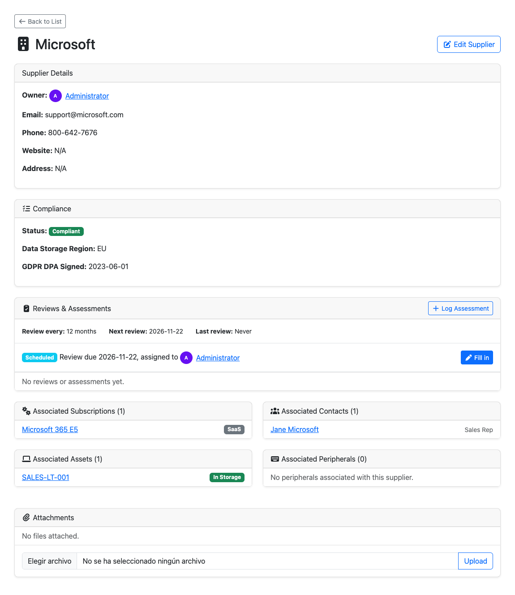
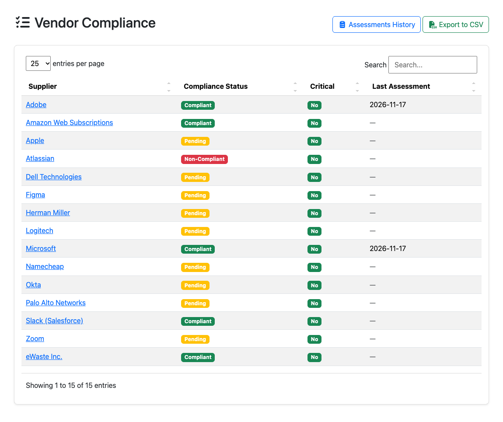

# Suppliers

The supplier module tracks the companies you buy from: their contact details, owner, compliance status, review schedule, contacts, and the subscriptions, assets and peripherals bought from them.

Suppliers are part of the **Procurement** module.

## Adding a supplier

1. Navigate to **Procurement → Suppliers**.
2. Click **Add Supplier**.
3. Provide the supplier details: **Name** (required), **Email**, **Phone**, **Address**, **Website** and **Notes**.
4. Set the **Owner**: the user or group accountable for the relationship. The owner is shown on the supplier list and detail page, and fills in the supplier's periodic reviews.
5. Under **Classification**, turn on **Critical Supplier** for suppliers your operations depend on.
6. Optionally set **Review every** and **Next review** to schedule periodic reviews (see [Supplier Reviews](supplier-reviews.md)).
7. Under **Compliance Details**, set the compliance **Status**, the **Data Storage Region** and any **Compliance Notes**.
8. Click **Save Supplier**.

### Supplier fields

| Field | Description |
|---|---|
| **Name** | Required. |
| **Email**, **Phone**, **Address**, **Website** | Contact details. The website is shown as a link on the detail page. |
| **Notes** | Free text about the relationship. |
| **Owner** | A user or a group, or no owner. |
| **Critical Supplier** | Switch in the **Classification** section. Critical suppliers show a red **Critical** badge next to their name on the supplier list and detail page. |
| **Review every** | No periodic reviews, 3, 6, 12 or 24 months. |
| **Next review** | Due date of the next periodic review. |
| **Status** | Compliance status: Pending, Compliant or Non-Compliant (see below). |
| **Data Storage Region** | EU or Outside EU. |
| **Compliance Notes** | Free text shown in the **Compliance** card of the detail page. |

## The supplier page

The supplier detail page shows:

- **Supplier Details** and **Compliance** cards with the fields above.
- **Reviews & Assessments**: the review schedule, any open review, and past reviews and assessments, with **Start review** and **Log Assessment** buttons.
- **Associated Subscriptions**, **Associated Contacts**, **Associated Assets** and **Associated Peripherals**.
- **Attachments** and **Compliance Links**.

Suppliers you no longer work with can be archived from the supplier list. Click **View Archived** to see them.

## Supplier contacts

Contacts are the people you deal with at a supplier. Each contact belongs to exactly one supplier.

1. Navigate to **Procurement → Contacts**.
2. Click **Add Contact**.
3. Provide **Name** (required), **Email**, **Phone**, **Role** and **Supplier** (required).

The supplier's contacts are listed in the **Associated Contacts** card on the supplier page. See [Requirements, Evaluations & Contacts](crm.md#contacts).

## Importing owners from CSV

The supplier CSV import accepts an optional `owner` column: an active user's email or a group name. The API exposes the owner as `owner_type` (`User` or `Group`) and `owner_id`.

## Periodic reviews

Suppliers with a review interval are reviewed automatically by their owner. See [Supplier Reviews](supplier-reviews.md).

## Compliance status

The compliance status reflects whether the supplier meets your security and regulatory requirements. You set it on the supplier form.

| Status | Meaning |
|---|---|
| **Pending** | Default for new suppliers. Not assessed yet, or assessment in progress. |
| **Compliant** | The supplier meets your requirements. |
| **Non-Compliant** | The supplier does not meet your requirements. |

## Vendor compliance overview

**Compliance → Vendor Compliance** (`/compliance/vendors`) lists every supplier with:

| Column | Shows |
|---|---|
| **Supplier** | Link to the supplier page. |
| **Compliance Status** | Pending, Compliant or Non-Compliant. |
| **Critical** | Yes for critical suppliers, otherwise No. |
| **Last Assessment** | Date of the most recent entry in the supplier's reviews and assessments. |

Use **Export to CSV** to download the table.

### Assessments history

Click **Assessments History** (`/compliance/assessments`) to see every supplier review and assessment, newest first, with supplier, assessment date, owner, status and notes.

To record an assessment done outside OpsDeck (for example a third-party audit report), open the supplier and click **Log Assessment**. Enter the **Assessment Date**, the **Status** (Pending Review, Approved or Rejected), optionally upload the report, and add notes. Questionnaire-based reviews are described in [Supplier Reviews](supplier-reviews.md).

These pages need access to the **Compliance** module.

## Linking to compliance controls

Suppliers can be linked to framework controls as evidence of vendor management practices (e.g., ISO 27001 A.15 — Supplier relationships):

1. On the supplier detail page, scroll to **Compliance Links** and click **Add Link**.
2. Select the **Framework** and **Control**.
3. In **Description / Justification**, explain the supplier's role in satisfying the requirement, then click **Link Control**.
