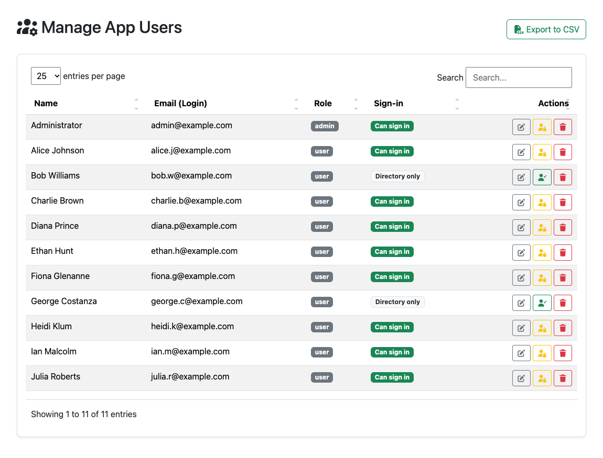

# Users & Groups

Manage user accounts, group memberships, role assignments, and the organization chart.

## User management

### Creating users

1. Navigate to **Administration → Users**.
2. Click **Add User**.
3. Provide: name, email, department, location, and role.
4. The user receives a temporary password, or signs in with Google or Microsoft if SSO is configured.
5. First login requires a password change.

Users can also be created and kept up to date from Microsoft Entra ID groups. See [Microsoft Entra ID](entra-id.md).

### Directory-only users

A user can exist in OpsDeck only as a directory entry, so that assets, peripherals, licences and suppliers can name them as owner or assignee without giving them access.

- In **Administration → Users**, each user shows **Can sign in** or **Directory only**. Admins can switch it. You cannot remove your own access or the break-glass admin's.
- A directory-only user is refused on every way in: password login, MFA, Google and Microsoft SSO, and API tokens. An open session ends on its next request after access is removed.
- Directory-only users still appear in user pickers, and the people list and detail page show a **Directory only** badge.
- OpsDeck sends no invitation or password-reset emails, so creating a directory-only user never notifies them.

Users created by the Entra ID sync are directory only by default.

### Roles

| Role | Description |
|---|---|
| **Admin** | Full system access including user management and configuration |
| **Manager** | Read/write access to operational data, limited admin capabilities |
| **User** | Read access to assigned data with limited write permissions |

### Custom properties

Users support custom fields (via `CustomPropertiesMixin`). Define custom fields in **Settings → Custom Properties** and they appear on all user forms.

## Groups

Groups provide permission inheritance — all members of a group receive the group's permissions:

1. Navigate to **Administration → Groups**.
2. Click **Add Group**.
3. Name the group and assign module permissions.
4. Add users as members.

When a user belongs to multiple groups, permissions are merged — the highest access level wins (WRITE > READ_ONLY).

## Organization chart

OpsDeck includes an interactive org chart:

- Navigate to **HR & People → Org Chart** to view the hierarchy.
- The chart is rendered using OrgChart.js.
- `OrgChartSnapshot` records capture point-in-time snapshots of the organizational structure.

## Permission assignment

See [Permissions & RBAC](../architecture/permissions.md) for the technical details of how permissions are resolved and cached.
